# Lab 2 explained simply: "Is this room comfortable?"

## The big idea

Your body is like a **little campfire**. All day and all night it makes heat, even when you sleep. The room around you is always **taking heat away**: through the air, the walls, the wind and your breath.

- If the room takes away **exactly as much heat as you make** → you feel **just right**.
- If the room takes away **too little** → heat piles up inside you → you feel **hot**.
- If the room takes away **too much** → you lose heat too fast → you feel **cold**.

Think of a **bathtub**: the tap is the heat your body makes, the drains are the ways heat leaves. If the water level rises, you are too hot. If it sinks, you are too cold. Level steady = comfortable.

The lab asks us to build a calculator that tells us **how warm people will feel** in a room (that number is called **PMV**, short for *Predicted Mean Vote*), and **how many people will complain** (that is **PPD**, *Predicted Percentage of Dissatisfied*).

*Figure: Six things decide if a person feels comfortable*

### What do PMV and PPD stand for?

> **PMV = Predicted Mean Vote.** A scientist called Fanger (Denmark, 1960s) put volunteers in special rooms, changed the temperature, wetness of the air, wind and clothes, and asked everybody to **vote** on a scale: −3 cold, −2 cool, −1 slightly cool, **0 just right**, +1 slightly warm, +2 warm, +3 hot.

> **Vote** = one person's answer.

> **Mean** = the *average* of a big group (add all votes, divide by the number of people).

> **Predicted** = we don't ask anyone. We **calculate** the vote with the body's heat balance (the bathtub: heat made minus heat lost).

> **PPD = Predicted Percentage of Dissatisfied.** Even when the *average* person is happy, some people are not. PPD says how many out of 100 would complain, meaning they feel **warm or hot (+2, +3) or cool or cold (−2, −3)**. It is never below 5 %: you can't please everyone.

> **ISO 7730** is the official rule-book that says how to calculate PMV and PPD (ISO = International Organization for Standardization).

> **ASHRAE 55** is a similar rule-book from a club of heating and cooling engineers (American Society of Heating, Refrigerating and Air-Conditioning Engineers).

## 1. Your engine: metabolism and metabolic rate

> **Metabolism** is your body burning food (the fuel) to keep you alive: heart beating, brain thinking, muscles moving. Burning makes **heat** as a by-product, just like a car engine gets warm.

> **Metabolic rate** ($M_{met}$) is how fast that engine is running. We measure it in **met**:

- **1 met** = sitting quietly. That is the "idle" speed of your engine. By definition, 1 met = **58.15 W/m²**.
- **1.2 met** = sitting and doing light desk work (this is our lab's person).
- More movement means a faster engine and more heat.

> **W/m²** (watts per square metre) says how much heat leaves each square metre of skin, like tiny light bulbs glowing on you; a watt is energy per second. We count per square metre so it works for small and big people alike.

Multiply by your skin area (about 1.8 m²) and you get the heat of the whole body. Sitting quietly gives about 105 W, about **one bright light bulb**!

The picture below also shows clothes.

> **Clothing insulation** ($I_{clo}$) says how thick and warm your clothes are, in **clo**: 0.5 clo = light summer clothes, 1 clo = a thick winter suit. Thick clothes slow the heat leaving your body.

*Figure: More clothes or more movement means you feel warmer*

    
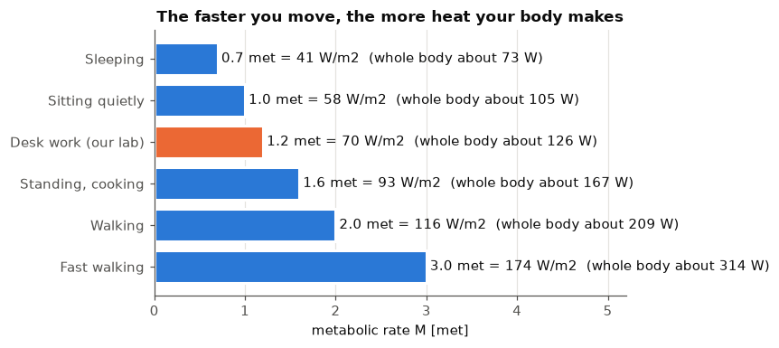
    

**Reading it.** Longer bar = faster engine = more heat to get rid of. That is why you feel warm after running and cosy under a blanket while sleeping. The orange bar is the person in our lab (1.2 met = 69.8 W/m²).

## 2. Six drains: where does the heat go?

Your body keeps its inside at about 37 °C. The heat it makes has to leave through **six drains** (in the formulas they are the *heat-loss paths* $RL_1$ to $RL_6$, each measured in W/m²):

> **$RL_1$**: water slowly **seeping through your skin** (you do not notice it) — dry air

> **$RL_2$**: **sweat** drying on your skin — working harder than sitting still

> **$RL_3$**: **wet breath**: water you breathe out — dry air, more activity

> **$RL_4$**: **warm breath**: you warm the air you breathe in — cold air

> **$RL_5$**: **radiation**: warmth glowing from your clothes to the walls — cold walls

> **$RL_6$**: **convection**: moving air carrying warmth away from your clothes — cold air, a breeze or fan

> **Left over** = heat made − heat lost through the six drains. We call it the **thermal load** ($L$).

*Figure: Your body is a little heater that gives its heat away in several ways*

    
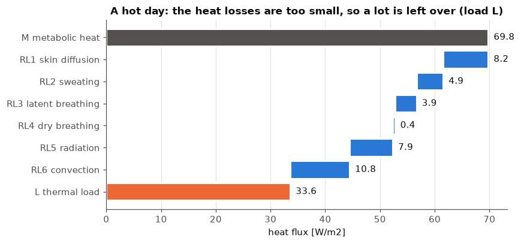
    

**Reading it.** Start at the top (grey = heat made, 69.8). Each blue bar takes a bite out of it. The orange bar is what is **still inside you** (33.6): your body is piling up heat, so you feel hot.

## 3. Comfortable, cold and hot: made vs lost

Same person, three rooms. For each room, compare **heat made** (grey) with **heat lost** (blue). The gap is the bathtub level rising or sinking.

    
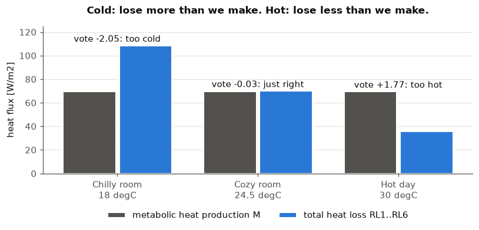
    

**Reading it.** In the cozy room the two bars are almost the same height, so the bathtub level stays steady. In the hot room the blue bar is too short. In the chilly room it is too tall.

## 4. The "feels-like" temperature: operative temperature

Imagine sitting in a room where the **air is a nice 24 °C**, but you are next to a **big cold window**. You still feel chilly, because your body sends its warmth *out to the cold window* (radiation). The thermometer only measures the air, so it misses this.

Three words first:

> **Air temperature** ($t_a$): how warm the air is, what a normal thermometer shows, in °C.

> **Mean radiant temperature** ($t_{mr}$): how warm the **walls, floor, ceiling and windows** are on average, in °C. "Radiant" means warmth that glows through the air, like the sun on your face.

> **Air speed** ($v$): how strong the **breeze** around you is, in m/s (metres per second). A fan makes it bigger.

> The **operative temperature** ($t_o$) fixes that. It is the room's **feels-like temperature**: a mix of air temperature and wall temperature.

$A$ is how much the **air** counts. With a calm room (air speed under 0.2 m/s) the air and the walls count **equally**: $A = 0.5$. With more wind, the air counts more (0.6, then 0.7).

*Figure: Cold windows make you feel cold even in warm air*

    
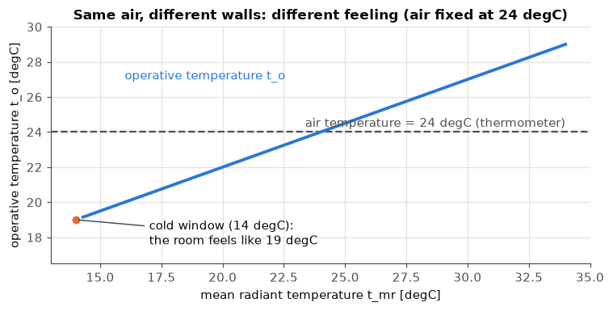
    

    Lab day: air 30, walls 30.5  ->  feels like 30.25 degC
    

**Reading it.** The dashed line is what the thermometer says (always 24 °C). The blue line is what you feel. Cold walls drag the feeling down, warm walls push it up. In the lab, air = 30 °C and walls = 30.5 °C, so the room **feels like 30.25 °C**.

## 5. Humidity: sticky air

Air can carry **invisible water**. Warm air can carry **much more** than cold air.

> **Relative humidity** (RH) says how full the air is: 60 % means it holds 60 % of the water it could possibly hold.

When the air is already full of water, your **sweat cannot dry**, so you stay hot and sticky. Dry air takes sweat away easily and you feel cooler.

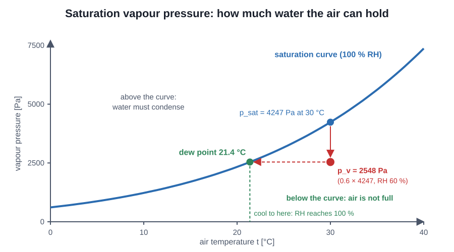

*Figure: The warmer the air, the more water it can hold; cool it and it overflows at the dew point*

    
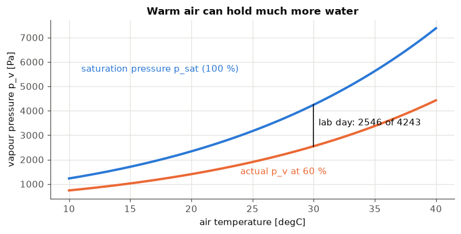
    

**Reading it.** The blue line goes up quickly: at 30 °C the air can hold 4243 "units" of water (Pa), at 10 °C only about 1228. At 60 % humidity our hot day has 2546 of them. In the program this number is called $p_v$ (partial vapour pressure).

## 6. Clothes and the surface-temperature guessing game

Clothes are a **blanket around you**. Their outside surface is cooler than your skin and warmer than the air. Its temperature, $t_{cl}$, decides how much heat leaves by radiation and moving air. But $t_{cl}$ depends on those same losses, so it is like a **chicken-and-egg** puzzle.

We solve it with a **guessing game** (an *iteration*):

1. Guess $t_{cl}$.
2. Use the guess to work out the heat leaving the clothes.
3. Use that to get a **better** $t_{cl}$.
4. Repeat until the new guess is **close enough** to the old one (less than $\epsilon$, a tiny number, in our case 0.0015).

Each round counts as **one iteration**. The lab says the hot day needs **8**.

*Figure: Guess, check, improve, repeat: the clothing-temperature game*

    
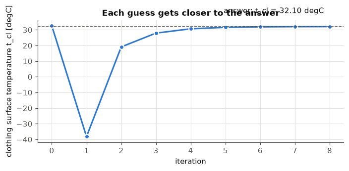
    

**Reading it.** The first guess is a bit off. Every new guess lands closer to the dashed line, and after 8 rounds the guesses stop changing, so we stop.

## 7. From heat left over to a vote (PMV)

People do not feel "watts", they feel warm or cold. So we multiply the heat left over ($L$) by a **sensitivity number** ($TS$, "thermal sensation") that turns watts into a vote:

The vote scale goes from **−3 (cold)** to **+3 (hot)**. **0 means just right.** The lab says a room is **comfortable if PMV is between −0.5 and +0.5**.

    
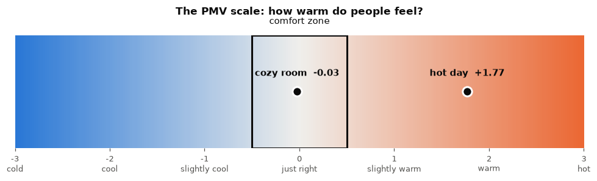
    

**Reading it.** Blue side = people feel cool. Orange side = people feel warm. The outlined box in the middle is the comfort zone. The hot day (+1.77) is between "warm" and "hot". The cozy room (about 0) is right in the middle.

## 8. Not everybody agrees: PPD

Even in a perfect room, people differ: one likes it warmer, one cooler. **PPD** tells us **out of 100 people, how many will complain**. Even at PMV = 0 about **5 out of 100** are still unhappy: you cannot please everyone!

*Figure: From cold to hot: the comfort vote*

    
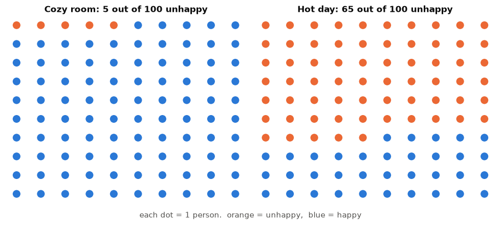
    

**Reading it.** Left: our cozy indoor room, only 5 people complain. Right: the hot day, **65 out of 100** are unhappy.

## 9. What can we change to feel better? (the "levers")

On the hot day PMV is +1.77: too warm. Which small change cools the people down the most? The chart shows how much the **vote changes** for each change we make (negative = cooler = good here).

    
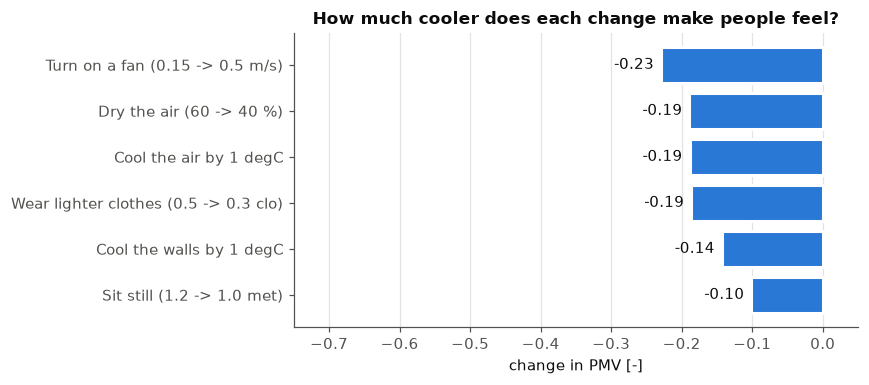
    

**Reading it.** Each bar shows how far the vote drops for that one change. A fan helps most (−0.23), then drier air, 1 °C cooler air and lighter clothes (about −0.19 each). The hot day starts at +1.77 and we need to get under +0.5, so we need a drop of more than 1.27. Even a fan, lighter clothes, drier air and sitting still **all together** only reach about +0.74. So the real fix is to **cool the air** by several degrees: that is what air conditioning does.

## 10. The answer

Side by side: the hot day outside (air 30 °C, walls 30.5 °C) and our cozy room inside (air 24.5 °C, walls 25 °C, which is the summer rule *walls = air + 0.5*). Humidity, air speed, clothes and activity are the same in both (60 %, 0.15 m/s, 0.5 clo, 1.2 met). Both needed **8 iterations** (rounds of guessing).

    
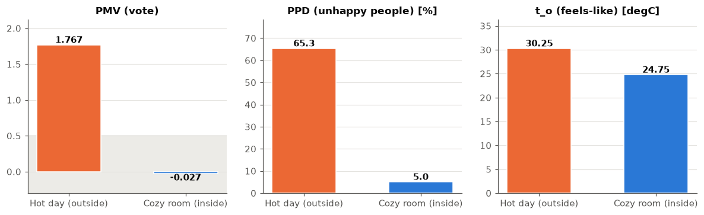
    

Any air temperature from about **23 °C to 26 °C** (walls = air + 0.5) keeps the vote between −0.5 and +0.5.

    Hot day:  PMV= 1.767   PPD= 65.3 %   t_o= 30.25 degC   n iterations= 8
    Cozy room:  PMV= -0.027   PPD= 5.0 %   t_o= 24.75 degC   n iterations= 8
