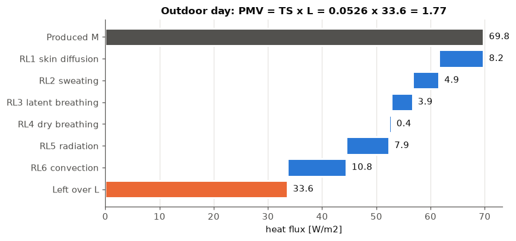
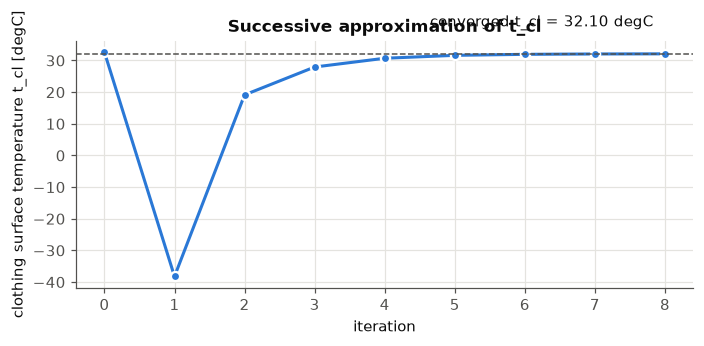
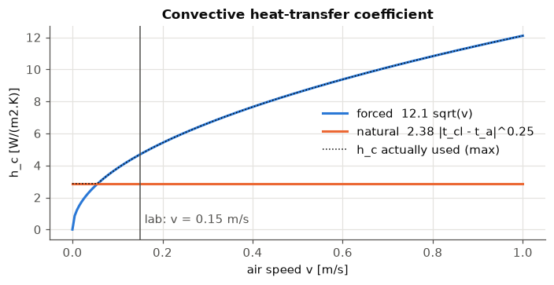
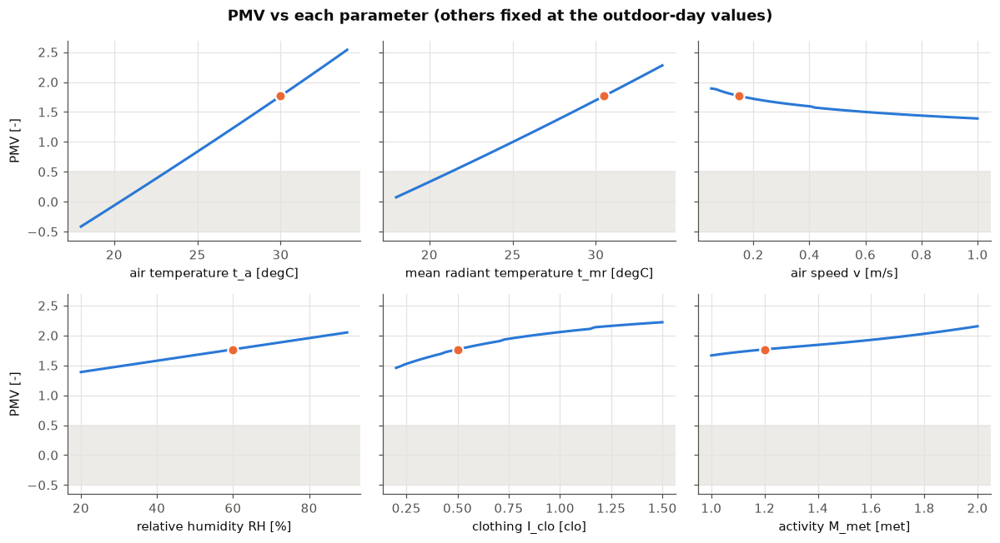
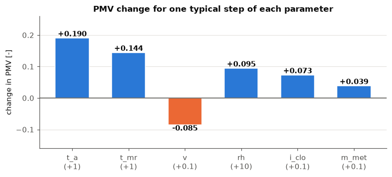
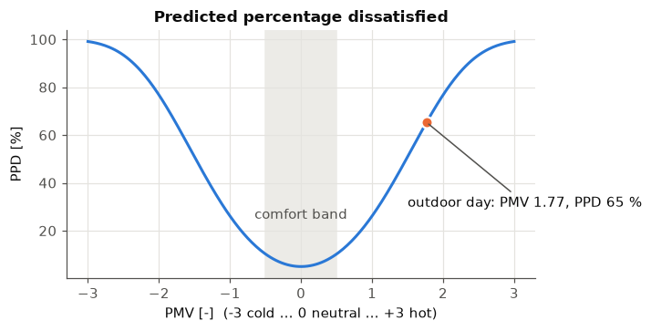
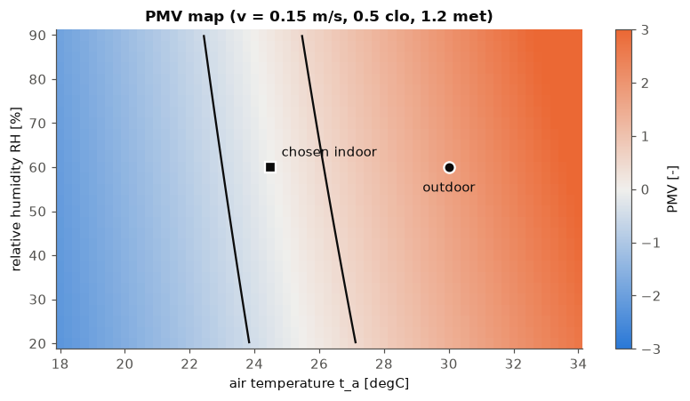
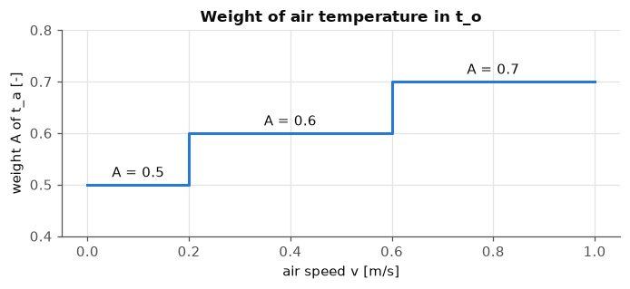
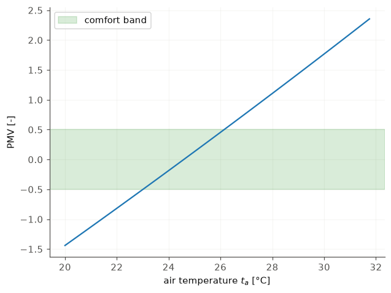

# Lab 2: PMV (Predicted Mean Vote), PPD (Predicted Percentage of Dissatisfied) and operative temperature (ISO 7730)

**Goal.** Compute the thermal-comfort indices for the summer day (outdoor air), then find indoor conditions with $-0.5 < PMV < 0.5$.

- **$t_a$**: air temperature — °C
- **$t_{mr}$**: mean radiant temperature (average temperature of the surrounding surfaces) — °C
- **$v$**: relative air speed — m/s
- **$RH$**: relative humidity — %
- **$I_{clo}$**: clothing insulation (1 clo = 0.155 m²·K/W) — clo
- **$M_{met}$**: metabolic rate (1 met = 58.15 W/m², a person sitting at rest) — met
- **$PMV$**: Predicted Mean Vote, scale −3 (cold) … 0 (neutral) … +3 (hot) — –
- **$PPD$**: Predicted Percentage of Dissatisfied — %
- **$t_o$**: operative temperature — °C

All heat flows are per m² of body surface (W/m²).

### What do PMV and PPD stand for, and where do they come from?

**PMV = Predicted Mean Vote.** In the 1960s the Danish professor P. O. Fanger put volunteers in climate chambers, changed the air temperature, humidity, air speed, clothing and activity, and asked them to **vote** on how they felt on the **7-point thermal sensation scale** (the ASHRAE scale): −3 cold, −2 cool, −1 slightly cool, 0 neutral, +1 slightly warm, +2 warm, +3 hot. He published the method in his book *Thermal Comfort* (1970).
- **Vote**: one person's answer on that 7-point scale.
- **Mean**: the average vote of a large group of people in the same room.
- **Predicted**: nobody is asked. The number is *calculated* from the six inputs ($t_a$, $t_{mr}$, $v$, relative humidity, clothing, activity) with the heat balance of the body: heat produced minus heat lost is the thermal load $L$, and $PMV=TS\cdot L$. If heat piles up ($L>0$) people vote warm, if the body loses heat faster than it makes it ($L<0$) they vote cool.

**PPD = Predicted Percentage of Dissatisfied.** People differ, so even in a room that is right for the average person some are unhappy. PPD is the percentage of a large group who would be *dissatisfied*, which means they would vote **warm or hot (+2, +3) or cool or cold (−2, −3)**. Fanger fitted this curve to the votes: $PPD = 100-95\,e^{-0.03353\,PMV^4-0.2179\,PMV^2}$. It is smallest (5 %) at $PMV=0$ and grows quickly on both sides.

**ISO 7730** (ISO = International Organization for Standardization) is the international standard that fixes how to calculate PMV and PPD, including the iteration of Step 3. **ASHRAE 55** (ASHRAE = American Society of Heating, Refrigerating and Air-Conditioning Engineers; standard 55, *Thermal Environmental Conditions for Human Occupancy*) uses the same model to define comfort zones.

## Abbreviations used in this notebook

- ****PMV****: Predicted Mean Vote — the calculated average comfort vote, scale −3 (cold) to +3 (hot)
- ****PPD****: Predicted Percentage of Dissatisfied — share of people who would complain, from PMV
- ****ISO****: International Organization for Standardization — ISO 7730 is the standard behind PMV and PPD
- ****ASHRAE****: American Society of Heating, Refrigerating and Air-Conditioning Engineers — ASHRAE 55 gives the comfort ranges
- ****RH**, $\varphi$**: relative humidity — $p_v/p_{sat}$, how full the air is
- ****clo****: clothing unit — 1 clo = 0.155 m²·K/W of clothing insulation
- ****met****: metabolic equivalent — 1 met = 58.15 W/m², a person sitting at rest
- ****TS****: thermal sensation (transfer coefficient) — converts the thermal load $L$ into the vote: $PMV = TS\cdot L$
- ****$RL_1 \dots RL_6$****: the six heat-loss paths (the sheet's labels, L for loss) — skin diffusion, sweating, breathing (2), radiation, convection
- ****$t_a$, $t_{mr}$, $t_o$, $t_{cl}$, $t_{dp}$****: air, mean radiant, operative, clothing-surface and dew-point temperature — °C
- ****I5****: the Romanian regulation named I5 in the lecture — comfort categories I to IV
- ****Pa, kJ, MJ, W****: pascal, kilojoule, megajoule, watt — units of pressure, energy and power

*Figure: The six factors that PMV combines*

## Step 2: unit conversions

- $M = M_{met}\cdot 58.15$ [W/m²]: metabolic heat produced per m² of skin.
- $I_{cl} = 0.155\cdot I_{clo}$ [m²·K/W]: thermal resistance of the clothes.
- $p_{sat}(t_a) = e^{16.6536-\frac{4030.183}{t_a+235}}$ [kPa] (Antoine equation): the maximum water-vapour pressure air can hold at $t_a$.
- $p_v = \frac{RH}{100}\cdot p_{sat}\cdot 1000$ [Pa]: the actual vapour pressure. Humid air ($p_v$ high) slows sweat evaporation, so you feel warmer.
- $f_{cl}=1+1.29\,I_{cl}$ if $I_{cl}<0.078$, else $1.05+0.645\,I_{cl}$ [–]: clothed area / nude area. Clothes enlarge the surface that exchanges heat.

*Figure: Typical values of clothing insulation (clo) and metabolic rate (met)*

    M=69.78 W/m2  I_cl=0.0775 m2K/W  p_sat=4243 Pa  p_v=2546 Pa  f_cl=1.100
    

## Step 3: clothing surface temperature $t_{cl}$ (iteration)

The clothes pass heat from the skin (≈ 35.7 °C minus a term for the work done by the body) to the room. In steady state:

but $RL_5$ and $RL_6$ themselves depend on $t_{cl}$, so we guess, recompute and repeat (ISO 7730 scheme, working with $x=T_{cl}/100$ in K/100). We stop when the old and new $x$ differ by less than $\epsilon = 0.0015$, i.e. 0.15 K. Averaging old and new value keeps the iteration stable. Kelvin conversion uses 273.15.

Convection coefficient [W/(m²·K)]: $h_c=\max(h_{c,f},h_{c,n})$ with forced $h_{c,f}=12.1\sqrt v$ (driven by air speed) and natural $h_{c,n}=2.38\,|t_{cl}-t_a|^{0.25}$ (driven by the temperature difference).

*Figure: The t_cl iteration: guess, correct, repeat until the change is below the stop band*

*Figure: How the body gives heat to its surroundings*

## Step 5: PMV and PPD

$TS$ is the *thermal sensation* transfer coefficient: it converts the thermal load $L$ into a vote.

$L>0$: the body produces more heat than it loses, so it feels warm (PMV > 0). $L<0$: it feels cold.

PPD never drops below 5 %: even at PMV = 0 some people are unhappy.

*Figure: The PMV scale from cold to hot and the comfort categories*

## Step 6: operative temperature

$t_o = A\,t_a+(1-A)\,t_{mr}$ with $A=0.5$ for $v<0.2$ m/s, $0.6$ for $0.2\le v<0.6$, $0.7$ for $v\ge0.6$. More air movement gives air temperature more weight.

*Figure: Cold surfaces: why operative temperature, not only air temperature, matters*

## Part 1: outdoor summer day

    PMV= 1.767
    PPD= 65.3 %
    t_o= 30.25 degC
    n iterations= 8
    

PMV ≈ 1.7 means "warm to hot" and about 62 % of people are dissatisfied.

> **Check against the sheet.** The lab sheet gives PMV = 1.767, PPD = 65.3 %, $t_o$ = 30.25 °C, $n$ = 8. The code reproduces all four.

## Visual guide: how the parameters and terms relate

Each chart below answers one question. Colours: blue = main series, orange = comparison or "too hot", grey = reference. The outdoor summer day is the baseline unless stated.

### 1. Where does the body's heat go? (heat balance)

The body produces $M$ [W/m²]. Six paths carry heat away. What is **left over** is the thermal load $L$. The sensation coefficient $TS$ turns that surplus into a vote: $PMV = TS\cdot L$. In a perfectly comfortable room $L \approx 0$ (production = losses).

    

    

**Reading it.** Grey = heat produced, blue = heat lost through each path, orange = surplus that is not removed, so the person feels warm. Radiation and convection (the "dry" paths) lose the most. They shrink when the room is as warm as the skin, which is exactly why hot rooms give a positive PMV.

### 2. The iteration for $t_{cl}$: how fast does it converge?

$t_{cl}$ appears on both sides of its own equation, so we start from a guess and refine it. Each pass changes it less than the previous one.

    

    

**Reading it.** Iteration 0 is the initial estimate. The curve flattens: we stop when the change falls below $\epsilon$ (here after 8 passes). The clothes sit between skin (≈ 34–35 °C) and air (30 °C), at about 32 °C.

### 3. Forced vs natural convection: which one wins?

$h_c=\max(h_{c,f},h_{c,n})$. Forced convection grows with air speed $v$; natural convection depends only on the clothes–air temperature difference. At low speed buoyancy wins, above a threshold the moving air wins.

    

    

**Reading it.** The crossover is at a very low speed (about 0.06 m/s), so for any normal room air speed forced convection is the one used. Higher $h_c$ means more convective loss $RL_6$, so a breeze lowers PMV.

### 4. Sensitivity: what moves PMV the most?

Each panel varies **one** parameter and keeps the others at the baseline (dot = outdoor day). The grey band is the comfort zone $-0.5<PMV<0.5$.

    

    

    

    

**Reading it.** Look at the sign and size of each line, and at the bar chart of the PMV change for a typical step.
- Higher $t_a$, $t_{mr}$, humidity, clothing and activity push PMV **up** (more heat kept or produced, or less evaporation). Higher air speed pushes it **down** (more convective loss).
- Ranking for a typical step: $t_a$ (+0.19 per °C) > $t_{mr}$ (+0.14 per °C) > humidity (+0.10 per 10 %) > air speed (−0.09 per 0.1 m/s) > clothing (+0.07 per 0.1 clo) > activity (+0.04 per 0.1 met).
- $t_a$ and $t_{mr}$ both enter through radiation and convection, so they are the main levers. $t_a$ also enters the dry breathing term and the vapour pressure.
- No single lever brings the outdoor day (PMV 1.77) into the grey band except a large drop in $t_a$ (about 6 °C), which is why the indoor solution cools the air.

### 5. From PMV to PPD

PPD $=100-95\,e^{-0.03353\,PMV^4-0.2179\,PMV^2}$ is symmetric (too cold is as bad as too hot) and **never below 5 %**.

    

    

### 6. Comfort map: temperature × humidity

Colour = PMV (blue = cool side, grey = neutral, orange = warm side). The black lines are the comfort limits $PMV=\pm0.5$. Here $t_{mr}=t_a+0.5$ as in the lab.

    

    

**Reading it.** The comfort region is the band between the two black lines. It tilts slightly: when the air is more humid, the same temperature feels warmer, so the comfortable temperature drops a little. Our indoor choice (square) lies inside it, the outdoor day (circle) is far on the warm side.

### 7. Operative temperature weights

$t_o=A\,t_a+(1-A)\,t_{mr}$. The weight $A$ of the air temperature steps up as air speed rises, because moving air strengthens convection relative to radiation.

    

    

**Reading it.** The lab case has $v=0.15<0.2$, so $A=0.5$ and $t_o$ is the plain average of $t_a$ and $t_{mr}$ (30.25 °C).

## Part 2: indoor conditions with $-0.5<PMV<0.5$

Same $RH$, $v$, clothing and activity. Only $t_a$ and $t_{mr}$ change. Sweep $t_a$ with $t_{mr}=t_a+0.5$ °C.

    -0.5 < PMV < 0.5 for t_a from 23.25 to 26.0 degC (grid step 0.25) (t_mr = t_a + 0.5)
    

    

    

    t_a=24.5  t_mr=25
    PMV= -0.027
    PPD= 5.0 %
    t_o= 24.75 degC
    n iterations= 8
    

**Answer.** $t_a = 24.5$ °C, $t_{mr}=25$ °C gives PMV ≈ −0.03 and PPD ≈ 5 %, practically neutral. Any $t_a$ from about 23.0 to 26.1 °C (with $t_{mr}=t_a+0.5$) stays inside the ±0.5 band. The outdoor air (30 °C) is about 5 °C too hot, which is why cooling is needed in summer.
