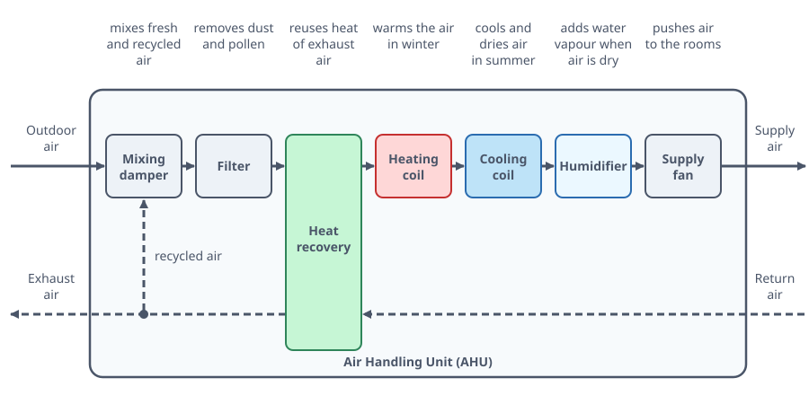
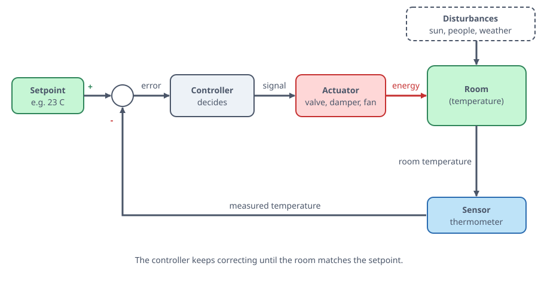
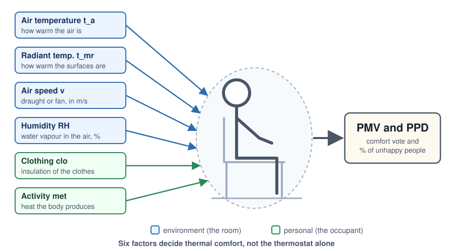
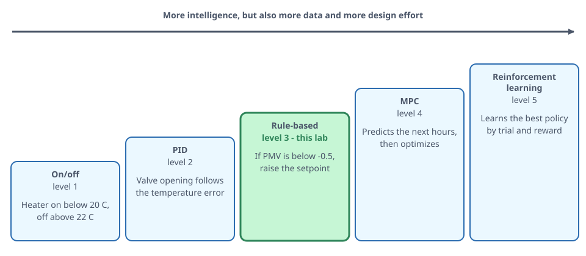
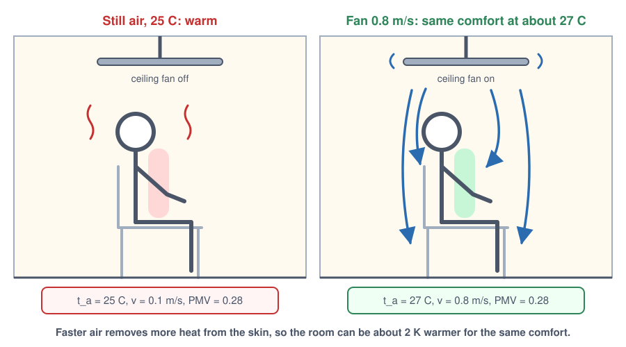
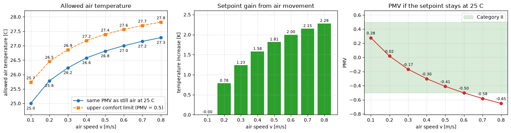
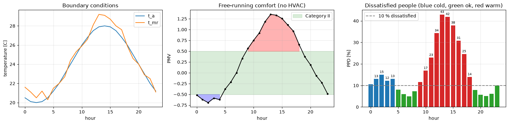
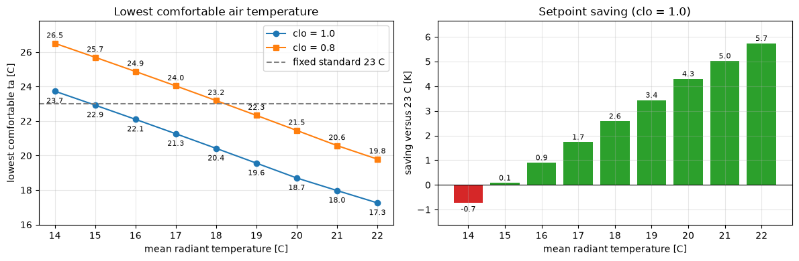
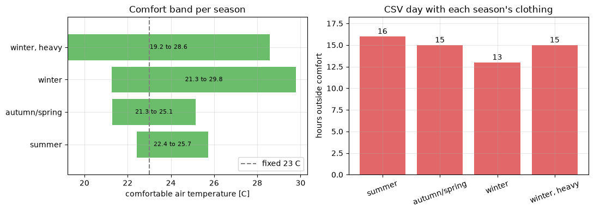

# App 2.3: Optimization of the HVAC setpoint, in depth

Sheet: *Dynamic Comfort and Energy Optimization (PMV/PPD)*.

# Part 0: What is HVAC and everything around it

## 0.1 The name

> **HVAC** (Heating, Ventilation and Air Conditioning): the set of machines that keep the *indoor environment* acceptable for people: temperature, humidity, fresh air and air movement.

* **H**eating: add heat in winter — e.g. a boiler, a heat pump, radiators, floor heating, an electric heater
* **V**entilation: bring fresh air in, take stale air out (CO$_2$, odours, moisture) — e.g. fans, ducts, a heat-recovery unit, windows
* **A**ir **C**onditioning: remove heat and moisture in summer — e.g. a chiller, a split unit, a cooling coil, a dehumidifier

> **Boiler**: heats water by burning gas or oil, or with electricity.

> **Heat pump**: moves heat from the outside air or the ground into the building, like an air conditioner running backwards; it delivers 3 to 4 units of heat per unit of electricity.

> **Radiator**: a hot water-filled panel that gives heat to the room.

> **CO$_2$** (carbon dioxide): the gas people breathe out, which builds up in a closed room.

> **Duct**: a metal tube that carries air.

> **Heat-recovery unit**: passes heat from the outgoing stale air to the incoming fresh air without mixing them.

> **Chiller**: a large refrigerator that makes cold water.

> **Split unit**: an air conditioner with an indoor and an outdoor part.

> **Coil**: a finned pipe carrying cold or hot water; air blown over a cooling coil is cooled, and a heating coil does the opposite.

> **Dehumidifier**: removes water vapour from the air.

## 0.2 The main parts and how they connect

A typical commercial building:

1. **Production**: boiler / heat pump (heat) and chiller (cold) make hot or cold water.
2. **AHU**: prepares the supply air.
3. **Distribution**: ducts and pipes carry air or water to the rooms; a **VAV box** throttles how much air each room gets.
4. **Terminals**: the devices in the room that hand heat or cold to the air: diffusers, fan-coil units, radiators, chilled beams and **ceiling fans**.
5. **Sensors + controller**: the room **thermostat**, humidity and CO$_2$ sensors and a **BMS**.

> **AHU** (Air Handling Unit): a box with a fan, filter, heating coil, cooling coil, humidifier and heat-recovery exchanger. It prepares the supply air.

> **VAV box** (Variable Air Volume): a box with a flap (damper) that throttles how much air each room gets.

> **Terminal**: a device in the room that hands heat or cold to the air.

> **Diffuser**: an air outlet in the ceiling.

> **Fan-coil unit**: a small coil with a fan.

> **Chilled beam**: a cooled panel under the ceiling.

> **CO$_2$ sensor**: shows how many people are in the room and how stale the air is.

> **BMS** (Building Management System): the central computer that runs the control logic of the whole building.

> **Thermostat**: the simplest controller. It has a temperature sensor, a **setpoint** (the temperature you want, set with a dial or an app) and a switch. It keeps comparing the measured air temperature $t_a$ with the setpoint: colder than the setpoint → heating on, warm enough → heating off (the logic is reversed for cooling). A fridge or an oven works the same way.

> **Relative humidity (RH)**: the water vapour in the air as a % of the most it could hold.

> **Sensor, controller, actuator**: three roles that come back throughout the lab. A **sensor** measures (temperature, relative humidity, CO$_2$), a **controller** decides by comparing the measurement with the setpoint (a thermostat, the BMS) and an **actuator** acts on the room (heater, valve, damper, fan).

*Figure: The whole HVAC chain from production to the room, with sensors and the BMS closing the loop*

*Figure: Inside an Air Handling Unit: what each component does to the air*

## 0.3 Key words you need for the sheet

> **Setpoint**: the target value the controller tries to hold, for example "air temperature = 23 °C".

> **Deadband**: a gap around the setpoint where nothing switches on. It stops the system from toggling every minute and saves energy.

> **Setback**: lowering the heating setpoint when nobody needs full comfort (night, weekend).

> **Load**: the heat per second that the system must add or remove to hold the setpoint, measured in watts.

> **Watt (W)**: the unit of power: 1 W = 1 joule per second.

> **Sensible vs latent load**: *sensible* heat changes the temperature; *latent* heat is the energy in water vapour (humidity). Cooling a humid summer day costs both.

> **Free running (no HVAC)**: the building follows the weather. Part 2 finds when this is uncomfortable.

> **Mean radiant temperature** $t_{mr}$: the average temperature of the surfaces around you: walls, windows, floor, ceiling. You feel them like the warmth of a stove or the chill of a cold window.

> **Operative temperature** $t_o$: roughly the average of air temperature $t_a$ and mean radiant temperature $t_{mr}$. The body feels *both*. In a room with cold windows you feel cold even if the air thermostat reads 22 °C.

> **ISO 7730 / EN 16798**: the international and European standards that define how thermal comfort is rated.

> **PMV** (Predicted Mean Vote): the average comfort vote of a group of people on a scale from −3 cold to +3 hot.

> **PPD** (Predicted Percentage of Dissatisfied): the share of people who would complain.

> **Comfort categories**: **I** $|PMV|<0.2$, **II** $|PMV|<0.5$ (normal new buildings, the target here), **III** $|PMV|<0.7$ (older buildings), outside = unacceptable.

*Figure: A control loop: setpoint, controller, actuator, room and sensor, with disturbances*

*Figure: A deadband keeps the heater from switching on and off all the time*

*Figure: Cold window surfaces: why operative temperature, not only air temperature, matters*

## 0.4 Why the thermostat is not the whole story

A classical thermostat controls only $t_a$. But comfort depends on **six factors**: $t_a$, $t_{mr}$, air speed $v$, humidity RH, clothing (clo) and activity (met). PMV combines all six into one number between -3 (cold) and +3 (hot). An AI controller that *computes PMV* can choose the cheapest setpoint that is still comfortable. That is the whole idea of this application.

> **clo**: how warm the clothes are: 0.5 light summer clothes, 1.0 a winter sweater.

> **met**: how much heat the body makes: 1.2 = seated office work.

*Figure: The six factors that PMV combines*

*Figure: How the body gives heat to its surroundings*

*Figure: The PMV scale and the comfort categories I, II and III*

## 0.5 How control logic is built (from simple to smart)

> **On/off**: switch at a threshold — e.g. heater on below 20 °C (this is the classical thermostat).

> **PID** (Proportional-Integral-Derivative): smooth correction that depends on the error (how far the measurement is from the setpoint), on how long it has lasted and on how fast it changes — e.g. valve opening follows $t_a - t_{set}$.

> **Rule-based**: if/else on measured conditions — e.g. **Part 3 of this sheet**.

> **MPC** (Model Predictive Control): use a model of the building to predict the next hours and pick the best plan — e.g. pre-cool before the afternoon peak.

> **RL** (Reinforcement Learning): a program learns by trial and reward which action to take in each situation (the *policy*) — e.g. DeepMind data-centre cooling.

*Figure: From simple to smart control: where this lab sits*

## 0.6 Why energy and comfort are linked

* Each °C of **extra heating setpoint** costs roughly **6 to 10 %** more heating energy (common engineering rule of thumb, it depends on the building).
* Each °C of **lower cooling setpoint** costs a similar amount of cooling energy.
* A **ceiling fan** uses 30 to 70 W; an air-conditioner **compressor** for the same room uses 1000 W or more. Moving air makes you feel cooler without lowering the real temperature, so we can raise the cooling setpoint. That is Part 1.

> **Compressor**: the pump of an air conditioner that does the cooling work and uses most of its electricity.

**Check with the App 2.2 numbers.**

**Reading a PMV value:** -3 cold, -2 cool, -1 slightly cool, **0 neutral**, +1 slightly warm, +2 warm, +3 hot.

    Exterior air (summer day in Romania):
    PMV= 1.768 PPD= 65.3 t_o= 30.25 n iterations= 8
    Interior air conditions:
    PMV= 0.064 PPD= 5.1 t_o= 25.25 n iterations= 8
    

**Interpretation.** Outdoors in summer (30 °C, 60 % RH) PMV = 1.77: people vote between "warm" and "hot" and 65 % are dissatisfied. Indoors at 25 °C and 50 % RH, PMV = 0.06 and PPD = 5.1 %, essentially neutral. The difference of 5 K in air temperature and 10 points of humidity moves the PMV by 1.7 units. Both runs converge in 8 iterations of the clothing temperature.

> **K** (kelvin): the unit for temperature differences: a difference of 1 K equals a difference of 1 °C.

# Part 1: Sensitivity analysis (ceiling fans)

**Task.** Standard summer office: clo = 0.5, met = 1.2, RH = 50 %, $t_{mr}=t_a+1$. Loop over $v$ from 0.1 to 0.8 m/s and show how many degrees $t_a$ can rise while the PMV stays the same.

**Method.** Fix a reference case (still air, $v=0.1$, $t_a=25$ °C) and record its PMV. For each higher $v$, solve `pmv(ta, ta+1, v) = PMV_ref` for $t_a$ with `brentq`. The difference to 25 °C is the allowed temperature increase.

> **Sensitivity analysis**: changes one input step by step and records how the output reacts.

> **Root finder** (`brentq`): a routine that searches the value of $t_a$ at which a function (here PMV minus the reference PMV) equals zero.

*Figure: Why a fan lets us raise the air temperature at the same comfort (Part 1)*

    Reference: ta=25 C, v=0.1 m/s -> PMV=0.278
    

    

    

### Interpretation of Part 1

* **Reference:** still air at 25 °C gives PMV = 0.278, so the room is already slightly on the warm side but inside Category II.
* **Gain:** raising $v$ from 0.1 to 0.8 m/s lets $t_a$ rise from 25 °C to about **27.3 °C**, an increase of **+2.3 K** at the same PMV. The upper comfort limit moves from 25.7 °C to 27.8 °C.
* **Diminishing returns:** the first step (0.1 to 0.2 m/s) buys **+0.8 K**, while the last step (0.7 to 0.8) buys only **+0.13 K**. The curve is concave because the cooling effect of moving air on skin and clothing saturates. This is why ceiling fans are run at moderate speed (0.3 to 0.6 m/s); above that, papers start to fly and the extra gain is small.
* **Energy meaning:** with the 6 to 10 % per °C rule, +2 K of cooling setpoint is roughly **12 to 20 % less cooling energy**, paid for by a fan that uses a few tens of watts. That justifies the **passive / hybrid cooling strategy**: fans first, compressor only when the fan alone is not enough.
* **Third chart:** if the setpoint stays at 25 °C and we add airflow, the PMV falls well below the reference value. That means we would be *over-cooling* and wasting energy.

> **Passive cooling**: cooling without the compressor.

# Part 2: Dynamic data processing with pandas

> **pandas**: the Python library for working with tables.

> **CSV file**: a plain-text table, one row per line, values separated by commas.

**Task.** The file `date_cladire_24h.csv` has 24 hourly rows of $t_a$, $t_{mr}$ and RH on a spring/autumn transition day. Apply the PMV function to every row and find the hours where the building leaves the comfort zone **without HVAC**.

**Assumptions** (the sheet does not fix them): light indoor clothing for a transition day **clo = 0.7**, seated office work **met = 1.2**, no fan, still indoor air **v = 0.1 m/s**.

    too cold: [0, 1, 2, 3, 4]
    too warm: [9, 10, 11, 12, 13, 14, 15, 16, 17, 18]
    Comfortable 9 of 24 h; worst PMV 1.35 at hour 13, coldest PMV -0.69 at hour 2
    

    

    

    clo=0.5: 16 h outside -> too cold [0, 1, 2, 3, 4, 5, 6, 22, 23], too warm [11, 12, 13, 14, 15, 16, 17]
    clo=0.7: 15 h outside -> too cold [0, 1, 2, 3, 4], too warm [9, 10, 11, 12, 13, 14, 15, 16, 17, 18]
    clo=1.0: 13 h outside -> too cold [], too warm [8, 9, 10, 11, 12, 13, 14, 15, 16, 17, 18, 19, 20]
    

### Interpretation of Part 2

* **Result (clo = 0.7):** 15 of 24 hours are outside Category II, so the building is comfortable only **9 h/day** by itself.
* **Two separate problems, one per time of day:**
  * **Night and early morning, hours 0 to 4** (PMV -0.52 to -0.69): the air is 20 to 20.5 °C and RH is high (62 to 70 %). The room is *slightly cool*; PPD reaches 15 % at hour 2, which is the coldest point (air 20.0 °C, $t_{mr}$ 20.5 °C).
  * **Late morning to evening, hours 9 to 18** (PMV 0.56 up to **1.35** at hour 13): the afternoon sun heats the air to 28 °C and the surfaces even more ($t_{mr}$ = 29.2 °C at hour 13, above $t_a$). PPD reaches **43 %**, so almost half of the occupants would complain.
* **Comfort window:** hours 5 to 8 and 19 to 23 are fine. Hour 7 has PMV = 0.00 (ideal, PPD = 5 %). In these hours **no HVAC is needed**, and the control system should switch off.
* **Mean radiant temperature matters:** in the afternoon $t_{mr} > t_a$ (solar gain on walls and glass), so the room feels hotter than the thermometer says. A thermostat on $t_a$ alone would under-react. In the early morning $t_{mr}$ is close to $t_a$ and the two agree.
* **Heating or cooling?** The day needs *both*: a little heating for hours 0 to 4 and cooling (or fans, see Part 1) for hours 9 to 18. This is typical of transition seasons and is why simple seasonal on/off logic wastes energy.
* **Sensitivity to clothing:** with clo = 0.5 the cold hours widen (0 to 6, 22, 23) and the warm hours shrink (11 to 17); with clo = 1.0 the cold hours disappear but hours 8 to 20 become too warm. The assumption about the occupants changes the answer, so a smart system should know or estimate clothing (for example from the season or the outdoor temperature of the last days).

# Part 3: Optimizing the HVAC setpoint (basis for AI)

**Scenario.** Extreme winter. Cold windows and walls make $t_{mr}$ low, and the HVAC controls only $t_a$. Write an optimization that returns the **lowest $t_a$ with PMV >= -0.5**, so the heating does no more than necessary.

**Assumptions.** Winter clothing clo = 1.0, met = 1.2, RH = 40 %, v = 0.1 m/s, and $t_{mr} = 17$ °C (about 4 K below a typical room, plausible next to a poorly insulated window).

PMV rises monotonically with $t_a$, so the lowest comfortable $t_a$ is the **root** of $PMV(t_a) = -0.5$. Two ways are shown: a `while` loop (what a simple controller would do) and `scipy.optimize.brentq`.

> **Monotonic function**: one that never goes down when its input goes up.

> **`while` loop**: repeats a small step until a goal is reached.

    while loop : ta_min = 21.30 C after 226 steps
    brentq     : ta_min = 21.265 C
    PMV at ta_min = -0.500, PPD = 10.2 %
    Saving versus the fixed 23 C standard: 1.74 K
    

    

    

### Interpretation of Part 3

* **Result:** with $t_{mr}$ = 17 °C and clo = 1.0, the lowest comfortable air temperature is **about 21.3 °C**, with PMV = -0.50 and PPD about 10 %. This matches the sheet's example (21.3 °C instead of the fixed 23 °C). The while loop and `brentq` agree to within the loop step (0.05 K); `brentq` needs only a handful of PMV evaluations, the loop needed 226 steps.
* **Saving:** holding 21.3 °C instead of 23 °C is **-1.7 K**. With the 6 to 10 % per °C rule that is about **10 to 17 % less heating energy** for the same occupant satisfaction (PPD <= 10 %).
* **Radiant compensation:** each +1 K of $t_{mr}$ lets the air be about **0.8 K cooler** (the curve drops from 23.7 °C at $t_{mr}$ = 14 to 18.0 °C at $t_{mr}$ = 21). The body reacts to both temperatures, and at low air speed the air still weighs slightly more than the surfaces. So **better windows or radiant heating can save more energy than a higher air setpoint.**
* **Clothing:** going from clo = 1.0 to 0.8 (a lighter sweater) raises the required air temperature by about 2.8 K at the same $t_{mr}$. Dressing for the season is a free "HVAC measure".
* **Why this is the basis for AI:** the function takes *measured conditions in* and returns a *setpoint out*, recomputed every few minutes. A smart controller (rule-based as here, or RL) just wraps this loop around live sensor data. The fixed 23 °C is a safe average that overheats whenever the walls are warm and underheats when they are very cold.
* **Limits:** the optimum sits exactly on the PMV = -0.5 boundary, so any sensor error pushes people into "slightly cool". A real controller keeps a small margin (for example target PMV = -0.4) and respects minimum ventilation and humidity requirements.

# Part 4: The same analysis for several seasons

> **Comfort band**: the lowest and highest $t_a$ with $-0.5 \le PMV \le 0.5$.

Comfort band and free-running day for several seasonal presets.

* summer: clo 0.5, met 1.2, RH 50 %, v 0.1, $t_{mr}$ $t_a + 1$ (sunny walls)
* autumn / spring: clo 0.7, met 1.2, RH 50 %, v 0.1, $t_{mr}$ $t_a$
* winter: clo 1.0, met 1.2, RH 40 %, v 0.1, $t_{mr}$ 17 °C (cold windows, sheet example)
* winter, heavy clothing: clo 1.2, met 1.2, RH 40 %, v 0.1, $t_{mr}$ 16 °C (heavier clothing, colder walls)

For each preset: lowest and highest $t_a$ with $-0.5 \le PMV \le 0.5$ (the comfort band), and how many hours of the CSV day fall outside comfort with that clothing.

    

    

### Interpretation of Part 4

* **The lower limit moves a lot with the season:** summer 22.4 °C, autumn/spring 21.3 °C, winter 21.3 °C (with 17 °C walls), winter with heavier clothing and colder walls 19.2 °C. So **one fixed setpoint cannot be right all year**; the cheapest comfortable value depends on clothing and wall temperature.
* **Summer has the narrowest band** (3.3 K, 22.4 to 25.7 °C): light clothing leaves little tolerance, and sunny surfaces ($t_{mr}=t_a+1$) make the room feel warmer. This is where fans (Part 1) help most, because they move the upper limit.
* **Winter bands are wide (8.5 and 9.4 K) only on paper.** The upper limits (29.8 and 28.6 °C) assume the walls stay at 17 or 16 °C while the air is hot, which never happens in practice. Read the winter row for its **lower limit**, the quantity the heating controller needs.
* **Clothing is the biggest lever:** clo 1.2 instead of 1.0 lowers the minimum air temperature by 2 K, but with 1 K colder walls. Both winter cases are valid; the difference is only the assumptions, so a report should always state them.
* **Free-running CSV day:** 16 h outside comfort with summer clothing, 15 h with autumn clothing, 13 h with winter clothing (15 h for the heavy winter case, clo 1.2). With heavy clothing the cold hours vanish but the afternoon becomes too warm. Autumn clothing (clo 0.7) is the best fit for this mild transition day, and it still fails 15 h, so this building needs active control in either direction.

# Summary of the four parts

* Part 1: +2.3 K at 0.8 m/s: air movement allows a warmer cooling setpoint, with diminishing returns
* Part 2: 15 of 24 h uncomfortable: night slightly cold, afternoon hot (PMV up to 1.35, PPD 43 %), $t_{mr}$ matters
* Part 3: 21.3 °C vs 23 °C: optimizer saves about 1.7 K of heating setpoint at the comfort limit
* Part 4: band 3.3 K (summer) to 8.5 K (winter): the comfortable air temperature depends on the season, clothing and wall temperature
