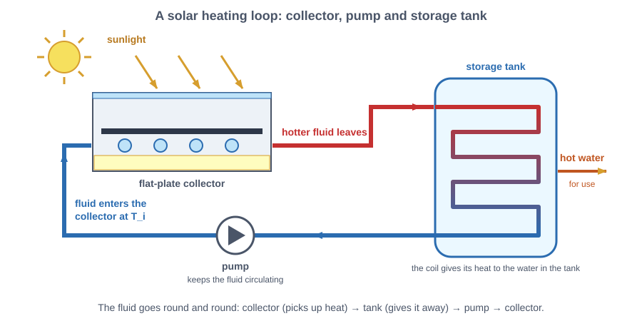
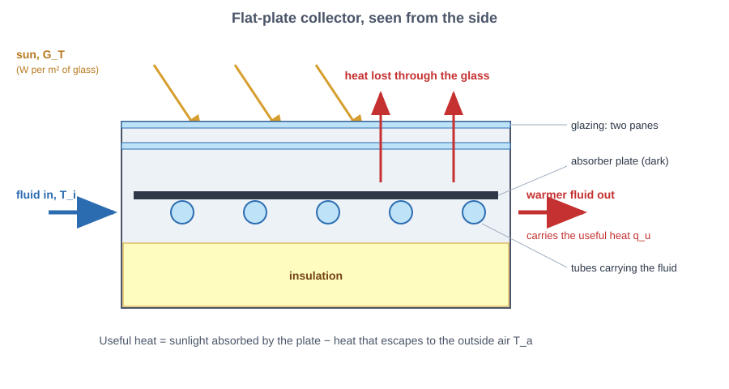
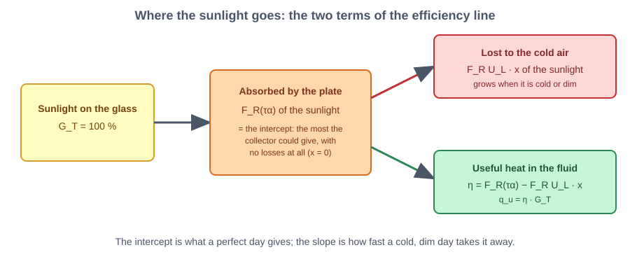
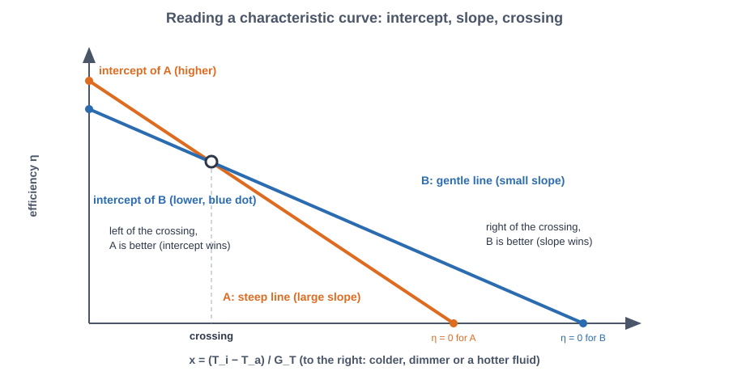
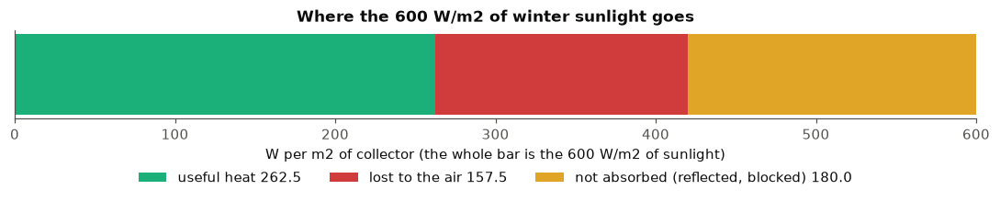
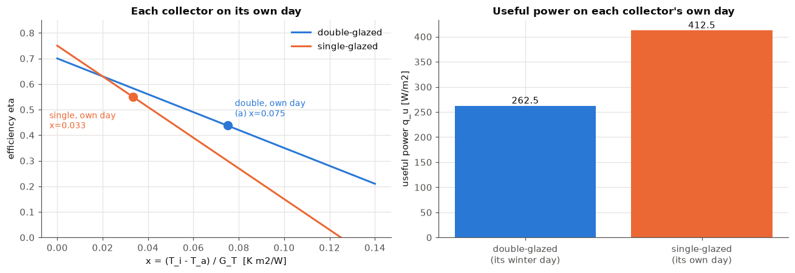
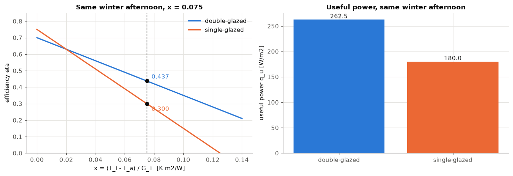
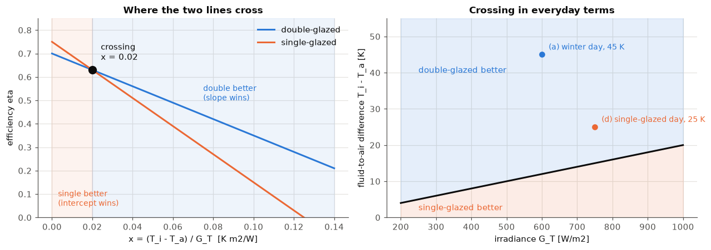
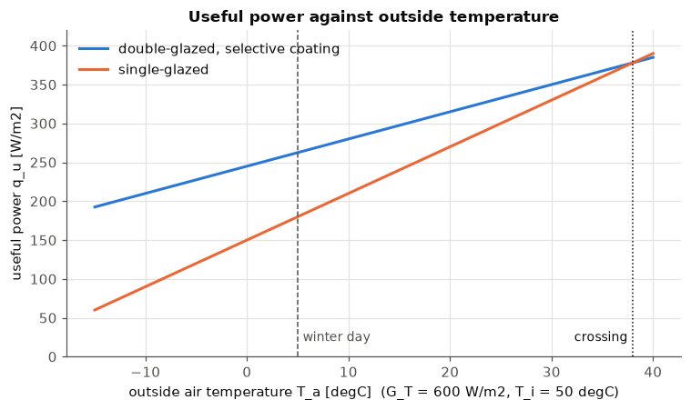

# Lab 5: Heating a liquid with sunlight, in depth

Sheet: *Apl. 3.2 Thermal Collector Exercise*. A panel that heats a liquid with sunlight is tested under different weather to see which design is better.

# Part 0: What a flat-plate collector does and how its efficiency is described

## 0.1 The collector

> **Solar thermal collector**: a device that absorbs solar radiation and transfers it as heat to a fluid. It produces heat, not electricity (that is the next lab).

> **Flat-plate collector**: the most common design: an insulated box with a transparent cover, a dark **absorber plate** inside and pipes (or channels) in thermal contact with the plate. Sunlight crosses the cover, the plate heats up, and the heat passes to the fluid in the pipes.

> **Absorber plate**: the metal plate that absorbs the radiation. It is dark and thin so that it heats up quickly and passes the heat to the pipes.

> **Working fluid**: the fluid (water, or water with antifreeze) that circulates through the pipes and carries the heat to where it is used (a storage tank, for example). "Fluid" is the general word for anything that flows, liquid or gas; here the working fluid is a liquid (some collectors use air, which is a fluid but not a liquid).

> **Glazing**: the transparent cover. It lets most sunlight in (short-wave radiation) and slows heat loss: the hot plate gives off long-wave (infrared) radiation, which glass mostly blocks, and the air layer between the panes reduces the heat carried away by moving air. A **single-glazed** collector has one pane and a **double-glazed** collector two. A second pane adds one more air layer against heat loss but also absorbs and reflects a few percent more of the incoming sunlight.

> **Selective coating**: a thin surface layer on the absorber that absorbs about 95 % of the sunlight but radiates only 5 to 10 % of the heat a plain black surface would radiate. It keeps the absorption high and the plate's own radiation loss low.

> **Insulation**: mineral wool or foam behind and at the edges of the plate so that heat does not leave through the back and the sides.

> **Irradiance** $G_T$ (W/m²): the solar power that arrives on one square metre of the collector's surface. The subscript T means that it is measured in the **tilted plane** of the collector, not on the horizontal ground. Typical values: about 1000 W/m² on a clear noon, a few hundred W/m² on a grey winter day.

> **Inlet temperature** $T_i$ (°C): the temperature of the working fluid where it enters the collector. In a solar heating loop this is the fluid coming back from the storage tank, after it has given its heat away, so it arrives about as warm as the tank itself (a tank at 50 °C sends it back at about 50 °C).

The tank does not ask the collector for a temperature. The collector adds heat to whatever fluid arrives, and the pump sends the warmer fluid to the tank, where it hands its heat over. The fluid comes back colder, about as warm as the tank, and the loop starts again. So the inlet temperature is set by the tank, not by the collector, and a warmer tank means a warmer inlet and a harder job for the collector (a larger $x$, defined below).

*Figure: A solar heating loop: the pump drives the fluid from the storage tank to the collector, where it is heated, and back to the tank, where it gives its heat away*

> **Ambient temperature** $T_a$ (°C): the temperature of the outside air around the collector. The collector loses heat to it.

> **Useful power** $q_u$ (W/m²): the heat power that ends up in the working fluid, per square metre of collector area. It is the quantity the exercise wants.

A **temperature difference** in °C is the same number as in kelvin (K): $(T_i - T_a)$ can be written in either unit.

*Figure: A flat-plate collector from the side: glazing, absorber plate with tubes, insulation, sunlight in, heat lost through the glass, heat carried out by the fluid*

## 0.2 Efficiency and the characteristic curve

> **Efficiency** $\eta$ (dimensionless): the fraction of the irradiance on the collector that leaves as useful heat, $\eta = q_u / G_T$. It depends on the weather and on the fluid temperature, so a single number is meaningless without an operating point.

An energy balance of the plate, with the heat loss approximated by a straight line in the temperature difference to the outside air, gives a straight line in the variable $x$. The sheet's equations are:

$$\eta = F_R(\tau\alpha) - F_R U_L \cdot x, \qquad x = \frac{T_i - T_a}{G_T}, \qquad q_u = \eta \cdot G_T$$

> **Intercept** $F_R(\tau\alpha)$ (dimensionless): the efficiency at $x = 0$, i.e. when the fluid enters at air temperature and the plate loses no heat. It is the product of the **transmittance** $\tau$ (the fraction of the sunlight the glazing lets through), the **absorptance** $\alpha$ (the fraction of that light the plate absorbs) and the **heat removal factor** $F_R$ (between 0 and 1: how close the fluid gets to the best case where the fluid is as hot as the plate, since in reality the plate is hotter than the fluid).

> **Loss coefficient** $U_L$ (W/(m² K)): the heat lost through glazing, back and edges per square metre of collector and per kelvin that the plate is warmer than the air.

> **Slope** $F_R U_L$ (W/(m² K)): the loss coefficient scaled by $F_R$. It is the speed at which the efficiency falls as $x$ grows. A selective coating and a second pane reduce it.

> **Reduced temperature** $x$ (K·m²/W): the single variable that combines the fluid-to-air temperature difference and the irradiance. It is large when the fluid is much hotter than the air or the sun is weak, so losses weigh more.

> **Characteristic curve**: the line $\eta(x)$. It is the way collectors are compared: it comes from a standardised test, and the two numbers (intercept and slope) describe the collector for every weather.

**Assumptions.** The losses are linear in $T_i - T_a$ (the real curve bends slightly, so the sheet's straight line is a first-order model), the fluid flow is constant and the collector is in steady state (nothing changes with time, so no heat is stored in the plate and the fluid).

Why a warmer inlet lowers the efficiency. The collector loses heat to the air roughly in proportion to its own temperature minus the air temperature, and the collector's temperature follows the fluid's, so a higher $T_i$ means a larger loss. On the sheet's winter afternoon ($T_a$ = 5 °C), an inlet at 50 °C gives a gap of 45 K and one at 20 °C a gap of 15 K, so the first leaks about three times more. The sunlight absorbed, $F_R(\tau\alpha)\,G_T$, does not depend on $T_i$, so a larger loss leaves less useful heat. In the characteristic line this is the term $F_R U_L\,x$: a higher $T_i$ raises $x$ and lowers $\eta$.

*Figure: Where the sunlight goes: the plate absorbs a share (the intercept) and loses a share that grows with x (the slope term)*

*Figure: Reading a characteristic curve: intercept, slope and crossing of two lines*

**Data from the sheet.** Double-glazed collector with selective coating: $F_R(\tau\alpha) = 0.70$, $F_R U_L = 3.5$ W/(m² K). Operating point of the winter afternoon: $G_T = 600$ W/m², $T_a = 5$ °C, $T_i = 50$ °C.

# Q(a), Q(b), Q(c): the double-glazed collector on a winter afternoon

**Task.** Compute (a) $x = (T_i - T_a)/G_T$, (b) the efficiency $\eta$, (c) the useful power $q_u = \eta\,G_T$.

    (a) x = 0.0750 K m2/W
    (b) eta = 0.4375  (43.7%)
    (c) q_u = 262.5 W/m2   (absorbed 420.0 - lost 157.5)
    

    

    

### Interpretation of Q(a) to Q(c)

* **(a) $x = 0.075$ K·m²/W.** A fluid 45 K above the air under 600 W/m² is a demanding operating point: the loss term is large compared with the sunlight.
* **(b) $\eta = 0.4375$ (43.75 %).** Of the 70 % the collector could use at $x = 0$, a loss term of $3.5 \times 0.075 = 0.2625$ is subtracted: 37.5 % of the absorbed energy is lost.
* **(c) $q_u = 262.5$ W/m².** A 4 m² array would deliver about 1.05 kW of heat. The energy balance of the figure closes: 420 W/m² absorbed minus 157.5 W/m² lost equals 262.5 W/m² useful. The remaining 180 W/m² of the sunlight never reaches the plate (glazing reflection and absorption, and the plate's own reflection), which is what the $\tau\alpha$ part of the intercept means.
* **Assumption that drives it:** a linear loss with a fixed $F_R U_L = 3.5$ W/(m² K). If the air were 10 K colder, $x$ would be 0.092 and $\eta$ would drop to 0.379.

# Q(d): the double-glazed collector against the single-glazed collector, each under its own weather

**Task.** Compare $q_u$ of Q(c) with a single-glazed collector under its own conditions ($G_T = 750$ W/m², $T_i = 45$ °C, $T_a = 20$ °C, $q_u = 412$ W/m²). Which wins and which term, intercept or slope, does the work in each scenario?

The sheet's extension gives the single-glazed collector's coefficients, $F_R(\tau\alpha) = 0.75$ and $F_R U_L = 6.0$ W/(m² K). They reproduce the sheet's value: $x = 0.0333$, $\eta = 0.55$, $q_u = 412.5$ W/m².

    single-glazed on its own day: x = 0.0333, eta = 0.5500, q_u = 412.5 W/m2 (sheet: 412, eta from sheet = 0.5493)
    double-glazed on its own day: x = 0.0750, eta = 0.4375, q_u = 262.5 W/m2
    double-glazed placed on the single-glazed day: eta = 0.5833, q_u = 437.5 W/m2
    share of the absorbed sunlight lost: single 26.7%, double 37.5%
    

    

    

### Interpretation of Q(d)

* **The single-glazed collector wins on its own day: 412 W/m² against 262.5 W/m².** Its efficiency is 55 % against 43.75 %, and its irradiance is 25 % higher (750 against 600 W/m²), so the gap in power is larger than the gap in efficiency.
* **Which term does the work.**
  * *Single-glazed, mild day.* $x = 0.033$ is small, so the loss term $6.0 \times 0.033 = 0.20$ takes only 27 % of the absorbed 0.75. The **intercept** (0.75, higher than 0.70) dominates, and the weak insulation is hardly punished.
  * *Double-glazed, cold day.* $x = 0.075$ is more than twice as large, so the loss term is $3.5 \times 0.075 = 0.2625$ and takes 37.5 % of the absorbed 0.70. Here the **slope** decides: with the single-glazed slope of 6.0 the loss would have been 0.45 and the collector would be at 0.25. The low slope is what keeps the double-glazed collector useful in the cold.
* **The weather, not the collector, wins this round.** At the single-glazed collector's own point $x = 0.033$ the double-glazed line gives $\eta = 0.583$, hence 437.5 W/m² at 750 W/m²: more than the 412 W/m². The two scenarios are not comparable, because they differ in $x$ and in $G_T$ at the same time. A fair comparison needs one operating point (Q(e)).
* **Assumption:** the single-glazed coefficients come from the extension of the sheet, and the sheet's 412 W/m² is rounded (the line gives 412.5).

# Q(e): both collectors under the same winter afternoon

**Task.** Evaluate both collectors at $G_T = 600$ W/m², $T_i = 50$ °C, $T_a = 5$ °C ($x = 0.075$). Which one is better?

    winter day (G_T=600, T_i=50, T_a=5):  double eta = 0.4375, q_u = 262.5 W/m2;  single eta = 0.3000, q_u = 180.0 W/m2
    better: double-glazed, selective coating, by a factor 1.46
    

    

    

### Interpretation of Q(e)

* **The double-glazed collector is better: 262.5 W/m² against 180 W/m²** (factor 1.46), efficiencies 43.75 % against 30 %.
* **The higher intercept of the single-glazed collector does not help.** At $x = 0.075$ its steep slope costs $6.0 \times 0.075 = 0.45$ of the 0.75, leaving 0.30, while the double-glazed collector loses 0.2625 of 0.70. The collector with the lower intercept wins because its losses grow more slowly.
* **Sensitivity.** The gap closes when $x$ falls (a warmer day, a lower fluid temperature or more sun) and flips at the crossing of Q(f). This is the reason for the sheet's note: judging by the intercept alone gives the wrong collector in winter.

# Q(f): where the two efficiency lines cross

**Task.** Find the value of $x$ where the two lines meet, and say which collector is better below it and why.

> **Crossing point**: the value of $x$ at which two collectors have the same efficiency. Setting the lines equal, $0.70 - 3.5\,x = 0.75 - 6.0\,x$, gives $x = 0.05/2.5$.

    crossing at x = 0.0200 K m2/W, where both have eta = 0.630
    below it: single-glazed; above it: double-glazed, selective coating
    G_T =  600 W/m2: crossing at a fluid-to-air difference of 12.0 K
    G_T =  750 W/m2: crossing at a fluid-to-air difference of 15.0 K
    G_T = 1000 W/m2: crossing at a fluid-to-air difference of 20.0 K
    

    

    

### Interpretation of Q(f)

* **The lines cross at $x = 0.02$ K·m²/W with $\eta = 0.63$.** The crossing exists because the single-glazed line starts higher (0.75 against 0.70) and falls faster (6.0 against 3.5).
* **Below $x = 0.02$ the single-glazed collector is better.** Losses are small there, so the intercept decides: more light gets in. **Above $x = 0.02$ the double-glazed collector is better:** the losses are large and the smaller slope decides.
* **In the units of the weather.** The crossing is a fixed temperature difference for a given irradiance: 12 K at 600 W/m² and 15 K at 750 W/m² (a crossing of 0.02 × $G_T$). If the fluid is less than 12 to 15 K above the air (heating a swimming pool, for example), the simple collector is as good or better. For domestic hot water or space heating in winter (30 to 50 K above the air), the double-glazed collector wins clearly.
* **Both operating points of this lab** ($x = 0.075$ and $x = 0.033$) are above the crossing, so under a common weather the double-glazed collector wins in both.
* **Assumption:** the straight lines of the sheet. Real collector curves bend a little at high $x$, which moves the crossing slightly.

# Limits of the model: when a collector gives nothing

> **Zero-efficiency point** (the idle or stagnation limit of the line): the value of $x$ where $\eta = 0$, i.e. $x = F_R(\tau\alpha) / F_R U_L$. Beyond it the collector would lose more than it absorbs, so the fluid is no longer heated.

    double-glazed, selective coating: eta = 0 at x = 0.200  ->  120 K at 600 W/m2, 200 K at 1000 W/m2
    single-glazed: eta = 0 at x = 0.125  ->  75 K at 600 W/m2, 125 K at 1000 W/m2
    

    

    

### Interpretation of the limits

* **Double-glazed: $\eta = 0$ at $x = 0.20$; single-glazed: at $x = 0.125$.** At 600 W/m² that is a fluid 120 K (double) or 75 K (single) hotter than the air. At 1000 W/m² the limits are 200 K and 125 K, so on a sunny day neither collector reaches its limit with ordinary hot water.
* **The plot shows the same story in another unit.** With the fluid at 50 °C and 600 W/m², the single-glazed collector is better only when the air is warmer than 38 °C, a rare condition; everywhere else the double-glazed collector gives more, and the gap widens as the air gets colder.
* **What the model ignores:** the dependence of the optical efficiency on the angle of the sun, the wind (it raises $U_L$), the heat stored in the plate (it matters at start-up), and the curvature of the real characteristic curve. For a first selection of a collector, the line and the operating point are enough.

# Summary

* **(a)** $x = 0.075$ K·m²/W. **(b)** $\eta = 0.4375$. **(c)** $q_u = 262.5$ W/m².
* **(d)** The single-glazed collector gives more on its own day (412 against 262.5 W/m²) because the day is mild: $x = 0.033$, so the intercept (0.75) does the work. In the cold winter day the slope term does it: 3.5 instead of 6.0. At the single-glazed day's own weather the double-glazed collector would give even more (437.5 W/m²).
* **(e)** On the same winter afternoon: double-glazed 262.5 W/m² (43.75 %), single-glazed 180 W/m² (30 %).
* **(f)** The lines cross at $x = 0.02$ K·m²/W ($\eta = 0.63$). Below it the single-glazed collector is better because of its higher intercept; above it the double-glazed collector is better because of its lower slope.
* **Never judge two collectors by the intercept alone: check the actual operating point.**
