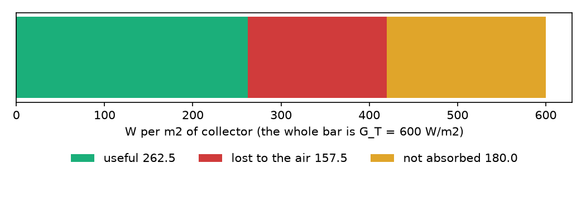
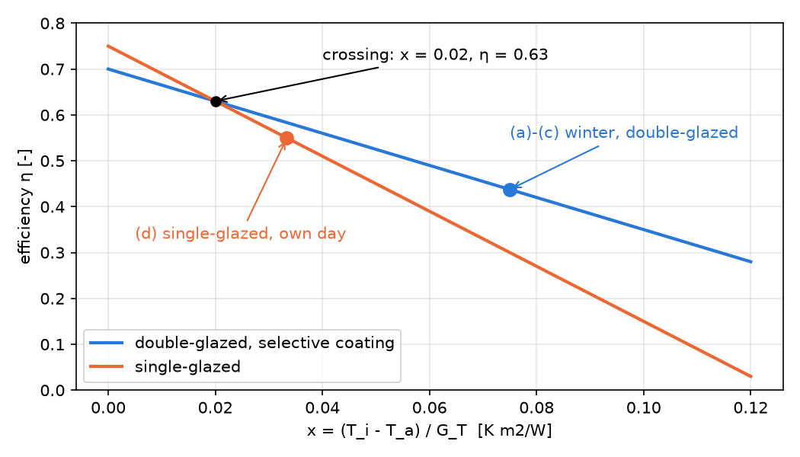

# Laboratory 5 - Solar to Thermal Energy Conversion

**Team 4**

Members:

- Layla EL-GHOUL
- Gabriel Constantin MORĂRAȘU-FILIP
- Mohamad-Mario SAKKA
- Abdelrahman MAHMOUD MIRGHANI
- Andra-Ioana URÎTU

## 1. Objective

In this lab we looked at a flat-plate solar collector, a panel that heats water with sunlight. First we computed the efficiency and the useful power of a double-glazed collector with a selective coating on a winter afternoon. Then we compared it with a single-glazed collector, once in each one's own weather and once in the same weather, and found where their efficiency lines cross.

## 2. Input data

We used the data from the lab sheet. The characteristic curve of a collector is:

> η = F_R(τα) − F_R·U_L · x,     x = (T_i − T_a) / G_T,     q_u = η · G_T

Here x is in K·m²/W, η has no unit and q_u is the useful power per m² of collector in W/m². A temperature difference in °C is the same difference in K.

| Quantity | Value |
|---|---|
| Double-glazed collector, intercept F_R(τα) | 0.70 |
| Double-glazed collector, slope F_R·U_L | 3.5 W/(m²K) |
| Single-glazed collector, intercept F_R(τα) | 0.75 |
| Single-glazed collector, slope F_R·U_L | 6.0 W/(m²K) |
| Winter afternoon: irradiance G_T | 600 W/m² |
| Winter afternoon: air temperature T_a | 5 °C |
| Winter afternoon: fluid inlet temperature T_i | 50 °C |
| Single-glazed collector, own day: G_T, T_i, T_a | 750 W/m², 45 °C, 20 °C |
| Single-glazed collector, own day: useful power q_u | 412 W/m² |

The single-glazed values (0.75 and 6.0) are given in the extension part of the sheet.

## 3. (a) Reduced temperature x

x grows with the gap between the fluid and the air and shrinks when the sun is stronger. For the winter afternoon:

> x = (T_i − T_a) / G_T = (50 − 5) / 600

```python
x_w = reduced_temperature(WINTER["t_i"], WINTER["t_a"], WINTER["g_t"])
print(f"(a) x = ({WINTER['t_i']:.0f} - {WINTER['t_a']:.0f}) / {WINTER['g_t']:.0f} = {x_w:.3f} K m2/W")
```

```text
(a) x = (50 - 5) / 600 = 0.075 K m2/W
```

x = 0.075 K·m²/W.

## 4. (b) Instantaneous efficiency η

We put x in the characteristic curve of the double-glazed collector:

> η = 0.70 − 3.5 · 0.075

```python
eta_w = efficiency(DOUBLE, x_w)
print(f"(b) eta = {DOUBLE['f_r_tau_alpha']:.2f} - {DOUBLE['f_r_u_l']:.1f} * {x_w:.3f} = {eta_w:.4f}  ({eta_w * 100:.2f} %)")
```

```text
(b) eta = 0.70 - 3.5 * 0.075 = 0.4375  (43.75 %)
```

η = 0.4375, so about 44 % of the sunlight becomes useful heat. With no losses it would be 70 %, but the loss term 3.5 · 0.075 = 0.2625 takes away more than a third of that.

## 5. (c) Useful power per m² of collector

> q_u = η · G_T = 0.4375 · 600

```python
q_w = useful_power(DOUBLE, WINTER["g_t"], WINTER["t_i"], WINTER["t_a"])
print(f"(c) q_u = {eta_w:.4f} * {WINTER['g_t']:.0f} = {q_w:.1f} W/m2")
```

```text
(c) q_u = 0.4375 * 600 = 262.5 W/m2
```

q_u = 262.5 W/m². A 4 m² collector would give about 1 kW. Of the 600 W/m² that arrive, 420 W/m² are absorbed (0.70 · 600) and 157.5 W/m² of that is lost to the cold air, which leaves 262.5 W/m².



## 6. (d) Which collector wins under its own weather?

The single-glazed collector has q_u = 412 W/m² on its own day (G_T = 750 W/m², T_i = 45 °C, T_a = 20 °C). We computed x and η for both days and compared the two terms of the curve, the intercept and the loss term.

```python
x_own = reduced_temperature(SINGLE_OWN["t_i"], SINGLE_OWN["t_a"], SINGLE_OWN["g_t"])
eta_own = efficiency_from_power(SINGLE_OWN["q_u"], SINGLE_OWN["g_t"])
print(f"(d) single-glazed, own day: x = {x_own:.3f}, eta = {eta_own:.3f}, q_u = {SINGLE_OWN['q_u']:.0f} W/m2")
print(f"    double-glazed, winter day: x = {x_w:.3f}, eta = {eta_w:.3f}, q_u = {q_w:.1f} W/m2")
print(f"    intercepts: double {DOUBLE['f_r_tau_alpha']:.2f}, single {SINGLE['f_r_tau_alpha']:.2f}")
print(f"    loss term F_R*U_L*x: double {DOUBLE['f_r_u_l'] * x_w:.4f}, single {SINGLE['f_r_u_l'] * x_own:.4f}")
q_d_own = useful_power(DOUBLE, SINGLE_OWN["g_t"], SINGLE_OWN["t_i"], SINGLE_OWN["t_a"])
print(f"    double-glazed on the single-glazed day would give {q_d_own:.1f} W/m2")
```

```text
(d) single-glazed, own day: x = 0.033, eta = 0.549, q_u = 412 W/m2
    double-glazed, winter day: x = 0.075, eta = 0.437, q_u = 262.5 W/m2
    intercepts: double 0.70, single 0.75
    loss term F_R*U_L*x: double 0.2625, single 0.2000
    double-glazed on the single-glazed day would give 437.5 W/m2
```

The single-glazed collector wins on its own day, 412 W/m² against 262.5 W/m², but the two days are very different. On its day the gap between the fluid and the air is only 25 K and the sun is strong, so x = 0.033 and the intercept does the work. The single-glazed collector has the higher intercept (0.75 against 0.70, because one glass sheet lets more sunlight through), and its large slope has little to act on (loss term 0.2). On the double-glazed winter day the gap is 45 K and the sun is weaker, so x = 0.075 and the slope does the work. The single-glazed collector would lose 6.0 · 0.075 = 0.45 of the sunlight there, while the double glazing with the selective coating loses only 0.2625. So (d) says more about the weather than about the collectors: the double-glazed collector would also give 437.5 W/m² on the single-glazed day.

## 7. (e) Both collectors under the same conditions (extension)

Now we put both collectors on the winter afternoon of (a): G_T = 600 W/m², T_i = 50 °C, T_a = 5 °C, so x = 0.075 for both.

```python
q_s = useful_power(SINGLE, WINTER["g_t"], WINTER["t_i"], WINTER["t_a"])
eta_s = efficiency(SINGLE, x_w)
print(f"(e) double-glazed: eta = {eta_w:.4f}, q_u = {q_w:.1f} W/m2")
print(f"    single-glazed: eta = {eta_s:.4f}, q_u = {q_s:.1f} W/m2")
print(f"    better: {better_collector(DOUBLE, SINGLE, x_w)['name']}  (ratio {q_w / q_s:.2f})")
```

```text
(e) double-glazed: eta = 0.4375, q_u = 262.5 W/m2
    single-glazed: eta = 0.3000, q_u = 180.0 W/m2
    better: double-glazed, selective coating  (ratio 1.46)
```

Under the same conditions the double-glazed collector is better: 262.5 W/m² against 180 W/m², which is 1.46 times more. This is the opposite of what the intercept alone suggests (0.75 against 0.70). The single-glazed collector loses 6.0 · 0.075 = 0.45 of the sunlight in the cold, while the double-glazed one loses only 0.2625.

## 8. (f) Where do the two efficiency lines cross? (extension)

The lines cross where the two efficiencies are equal:

> 0.70 − 3.5 · x = 0.75 − 6.0 · x   ⇒   x = (0.75 − 0.70) / (6.0 − 3.5)

```python
x_c = crossing(DOUBLE, SINGLE)
eta_c = efficiency(DOUBLE, x_c)
print(f"(f) lines cross at x = {x_c:.3f} K m2/W, eta = {eta_c:.3f}")
print(f"    just below the crossing (x = {x_c - 0.01:.2f}): {better_collector(DOUBLE, SINGLE, x_c - 0.01)['name']}")
print(f"    just above the crossing (x = {x_c + 0.01:.2f}): {better_collector(DOUBLE, SINGLE, x_c + 0.01)['name']}")
print(f"    at G_T = {WINTER['g_t']:.0f} W/m2 this is a fluid {x_c * WINTER['g_t']:.0f} K above the air; "
      f"at {SINGLE_OWN['g_t']:.0f} W/m2 it is {x_c * SINGLE_OWN['g_t']:.0f} K")
```

```text
(f) lines cross at x = 0.020 K m2/W, eta = 0.630
    just below the crossing (x = 0.01): single-glazed
    just above the crossing (x = 0.03): double-glazed, selective coating
    at G_T = 600 W/m2 this is a fluid 12 K above the air; at 750 W/m2 it is 15 K
```

The lines cross at x = 0.02 K·m²/W, where both have η = 0.63. For smaller x (mild weather, strong sun, small gap between the fluid and the air) the single-glazed collector is better, because the intercept decides. For larger x (cold weather, weak sun or a hot fluid) the double-glazed collector is better, because the slope decides. At G_T = 600 W/m² the crossing is a fluid only 12 K above the air, at 750 W/m² it is 15 K. Our winter afternoon (x = 0.075) and the single-glazed own day (x = 0.033) are both above it, so the double-glazed collector is better on both days: on the single-glazed day it would give 437.5 W/m² against 412 W/m².



## 9. Conclusions

- On the winter afternoon (G_T = 600 W/m², T_i = 50 °C, T_a = 5 °C) the double-glazed collector has x = 0.075 K·m²/W, η = 0.4375 and gives q_u = 262.5 W/m².
- The single-glazed collector gives more on its own day (412 W/m²) only because that day is mild: it wins by its higher intercept at small x. Under the winter conditions it gives only 180 W/m², so the double-glazed collector is 1.46 times better.
- The two efficiency lines cross at x = 0.02 K·m²/W (η = 0.63). Below it the intercept decides and the single-glazed collector wins, above it the slope decides and the double-glazed collector wins. We should never judge two collectors by the intercept alone: we always have to check the real operating point.

---pagebreak---

## Annex: full code

### A.1 solve_lab_5.py

```python
import os
import sys

import numpy as np
import matplotlib
matplotlib.use("Agg")
import matplotlib.pyplot as plt

HERE = os.path.dirname(os.path.abspath(__file__))
sys.path.insert(0, os.path.join(HERE, "..", "shared"))
from solar_thermal import (DOUBLE, SINGLE, WINTER, SINGLE_OWN, reduced_temperature, efficiency,
                           useful_power, crossing, better_collector, efficiency_from_power)

x_w = reduced_temperature(WINTER["t_i"], WINTER["t_a"], WINTER["g_t"])
print(f"(a) x = ({WINTER['t_i']:.0f} - {WINTER['t_a']:.0f}) / {WINTER['g_t']:.0f} = {x_w:.3f} K m2/W")

eta_w = efficiency(DOUBLE, x_w)
print(f"(b) eta = {DOUBLE['f_r_tau_alpha']:.2f} - {DOUBLE['f_r_u_l']:.1f} * {x_w:.3f} = {eta_w:.4f}  ({eta_w * 100:.2f} %)")

q_w = useful_power(DOUBLE, WINTER["g_t"], WINTER["t_i"], WINTER["t_a"])
print(f"(c) q_u = {eta_w:.4f} * {WINTER['g_t']:.0f} = {q_w:.1f} W/m2")

x_own = reduced_temperature(SINGLE_OWN["t_i"], SINGLE_OWN["t_a"], SINGLE_OWN["g_t"])
eta_own = efficiency_from_power(SINGLE_OWN["q_u"], SINGLE_OWN["g_t"])
print(f"(d) single-glazed, own day: x = {x_own:.3f}, eta = {eta_own:.3f}, q_u = {SINGLE_OWN['q_u']:.0f} W/m2")
print(f"    double-glazed, winter day: x = {x_w:.3f}, eta = {eta_w:.3f}, q_u = {q_w:.1f} W/m2")
print(f"    intercepts: double {DOUBLE['f_r_tau_alpha']:.2f}, single {SINGLE['f_r_tau_alpha']:.2f}")
print(f"    loss term F_R*U_L*x: double {DOUBLE['f_r_u_l'] * x_w:.4f}, single {SINGLE['f_r_u_l'] * x_own:.4f}")
q_d_own = useful_power(DOUBLE, SINGLE_OWN["g_t"], SINGLE_OWN["t_i"], SINGLE_OWN["t_a"])
print(f"    double-glazed on the single-glazed day would give {q_d_own:.1f} W/m2")

q_s = useful_power(SINGLE, WINTER["g_t"], WINTER["t_i"], WINTER["t_a"])
eta_s = efficiency(SINGLE, x_w)
print(f"(e) double-glazed: eta = {eta_w:.4f}, q_u = {q_w:.1f} W/m2")
print(f"    single-glazed: eta = {eta_s:.4f}, q_u = {q_s:.1f} W/m2")
print(f"    better: {better_collector(DOUBLE, SINGLE, x_w)['name']}  (ratio {q_w / q_s:.2f})")

x_c = crossing(DOUBLE, SINGLE)
eta_c = efficiency(DOUBLE, x_c)
print(f"(f) lines cross at x = {x_c:.3f} K m2/W, eta = {eta_c:.3f}")
print(f"    just below the crossing (x = {x_c - 0.01:.2f}): {better_collector(DOUBLE, SINGLE, x_c - 0.01)['name']}")
print(f"    just above the crossing (x = {x_c + 0.01:.2f}): {better_collector(DOUBLE, SINGLE, x_c + 0.01)['name']}")
print(f"    at G_T = {WINTER['g_t']:.0f} W/m2 this is a fluid {x_c * WINTER['g_t']:.0f} K above the air; "
      f"at {SINGLE_OWN['g_t']:.0f} W/m2 it is {x_c * SINGLE_OWN['g_t']:.0f} K")

FIG = os.path.join(HERE, "figures")
os.makedirs(FIG, exist_ok=True)
x = np.linspace(0, 0.12, 200)
fig, ax = plt.subplots(figsize=(7, 4))
ax.plot(x, efficiency(DOUBLE, x), color="#2a78d6", lw=2, label="double-glazed, selective coating")
ax.plot(x, efficiency(SINGLE, x), color="#eb6834", lw=2, label="single-glazed")
ax.plot(x_c, eta_c, "ko")
ax.annotate(f"crossing: x = {x_c:.2f}, η = {eta_c:.2f}", (x_c, eta_c), xytext=(0.04, 0.72), arrowprops=dict(arrowstyle="->"))
ax.plot(x_w, eta_w, "o", color="#2a78d6", ms=8)
ax.annotate("(a)-(c) winter, double-glazed", (x_w, eta_w), xytext=(0.075, 0.55), arrowprops=dict(arrowstyle="->", color="#2a78d6"), color="#2a78d6")
ax.plot(x_own, eta_own, "o", color="#eb6834", ms=8)
ax.annotate("(d) single-glazed, own day", (x_own, eta_own), xytext=(0.005, 0.33), arrowprops=dict(arrowstyle="->", color="#eb6834"), color="#eb6834")
ax.set_xlabel("x = (T_i - T_a) / G_T  [K m2/W]")
ax.set_ylabel("efficiency η [-]")
ax.set_ylim(0, 0.8)
ax.grid(alpha=0.3)
ax.legend(loc="lower left")
fig.tight_layout()
fig.savefig(os.path.join(FIG, "efficiency-lines.png"), dpi=150)
plt.close(fig)

fig, ax = plt.subplots(figsize=(7, 2.6))
absorbed = DOUBLE["f_r_tau_alpha"] * WINTER["g_t"]
lost = DOUBLE["f_r_u_l"] * x_w * WINTER["g_t"]
ax.barh(0, q_w, color="#1baf7a", label=f"useful {q_w:.1f}")
ax.barh(0, lost, left=q_w, color="#d03b3b", label=f"lost to the air {lost:.1f}")
ax.barh(0, WINTER["g_t"] - absorbed, left=absorbed, color="#e0a52a", label=f"not absorbed {WINTER['g_t'] - absorbed:.1f}")
ax.set_yticks([])
ax.set_xlabel("W per m2 of collector (the whole bar is G_T = 600 W/m2)")
ax.legend(loc="upper center", bbox_to_anchor=(0.5, -0.45), ncol=3, frameon=False)
fig.tight_layout()
fig.savefig(os.path.join(FIG, "winter-energy-split.png"), dpi=150)
plt.close(fig)
```

### A.2 solar_thermal.py

```python
DOUBLE = dict(name="double-glazed, selective coating", f_r_tau_alpha=0.70, f_r_u_l=3.5)
SINGLE = dict(name="single-glazed", f_r_tau_alpha=0.75, f_r_u_l=6.0)

WINTER = dict(g_t=600.0, t_i=50.0, t_a=5.0)
SINGLE_OWN = dict(g_t=750.0, t_i=45.0, t_a=20.0, q_u=412.0)

def reduced_temperature(t_i, t_a, g_t):
    return (t_i - t_a) / g_t

def efficiency(collector, x):
    return collector["f_r_tau_alpha"] - collector["f_r_u_l"] * x

def useful_power(collector, g_t, t_i, t_a):
    return efficiency(collector, reduced_temperature(t_i, t_a, g_t)) * g_t

def crossing(a, b):
    d_slope = a["f_r_u_l"] - b["f_r_u_l"]
    if d_slope == 0:
        return None
    return (a["f_r_tau_alpha"] - b["f_r_tau_alpha"]) / d_slope

def stagnation_x(collector):
    return collector["f_r_tau_alpha"] / collector["f_r_u_l"]

def better_collector(a, b, x):
    return a if efficiency(a, x) >= efficiency(b, x) else b

def efficiency_from_power(q_u, g_t):
    return q_u / g_t
```
