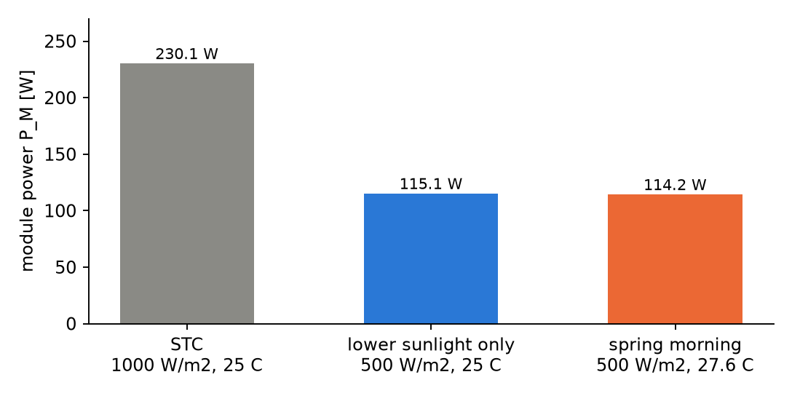
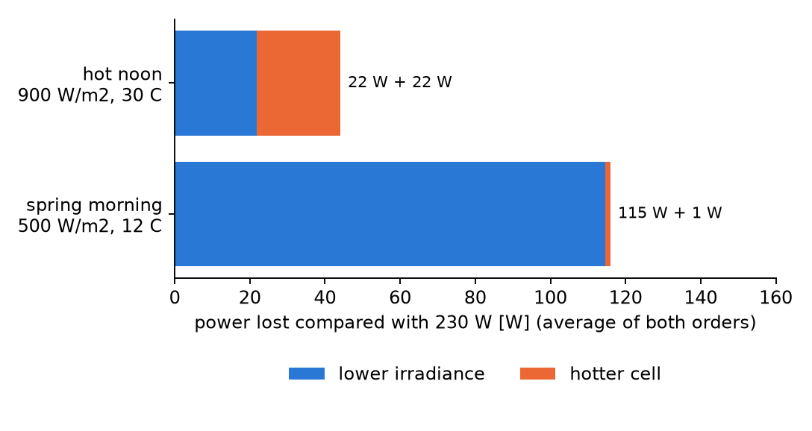

# Laboratory 6 - Solar to Electric Energy Conversion

**Team 4**

Members:

- Layla EL-GHOUL
- Gabriel Constantin MORĂRAȘU-FILIP
- Mohamad-Mario SAKKA
- Abdelrahman MAHMOUD MIRGHANI
- Andra-Ioana URÎTU

## 1. Objective

In this lab we evaluated a Kyocera KD230GX-LPB photovoltaic module on a cool, clear spring morning (G = 500 W/m², t_a = 12 °C, w = 3 m/s). We calculated the temperature of the cells with the NOCT model, then the current, the voltage and the power of the module, and we compared the result with the rated power of 230 W and with the hot-noon example (about 80 %). At the end we separated how much of the lost power comes from the weaker sunlight and how much from the cell temperature.

## 2. Input data

We used the module data and the equations from the lab sheet. The values are given at standard test conditions (STC): G_st = 1000 W/m² and t_c,st = 25 °C.

| Quantity | Value |
|---|---|
| Open-circuit voltage U_0,st | 36.9 V |
| Short-circuit current I_sc,st | 8.36 A |
| Rated power P_M,st | 230 W |
| Nominal operating cell temperature NOCT | 45 °C |
| Temperature coefficient of I_sc, μ_Isc | +0.06 %/°C = 0.0006 · I_sc,st |
| Temperature coefficient of U_0, μ_U0 | -0.36 %/°C = -0.0036 · U_0,st |
| Fill factor FF | 0.746 |

The equations of the simplified model are:

> t_c = t_a + (NOCT - 20) / 800 · G
> I_L = (G / G_st) · [I_sc,st + μ_Isc · (t_c - t_c,st)],   I_sc = I_L
> U_0 = U_0,st + μ_U0 · (t_c - t_c,st)
> P_M = FF · U_0 · I_sc

We assumed, as the sheet says, that FF stays constant. The reference temperature of the coefficients is always t_c,st = 25 °C, never 0 °C. The wind speed w = 3 m/s is given in the problem, but the NOCT model does not use it: the NOCT value already contains a standard wind of 1 m/s, so w does not enter any of the equations.

## 3. (a) Cell temperature

The cells are hotter than the air because they absorb sunlight and cannot shed all the heat. The NOCT model adds (NOCT - 20) / 800 = 0.03125 K to the air temperature for each W/m² of irradiance:

> t_c = t_a + (NOCT - 20) / 800 · G = 12 + 0.03125 · 500

```python
from pv_module import (G_MORNING, TA_MORNING, G_NOON, TA_NOON, PM_ST,
                       operating_point, loss_split, relative_efficiency)

m = operating_point(G_MORNING, TA_MORNING)
print(f"(a) tc = {m['tc']:.2f} C   (air {m['ta']:.0f} C + {m['tc'] - m['ta']:.2f} K of heating by the sun)")
```

Output:

```text
(a) tc = 27.62 C   (air 12 C + 15.62 K of heating by the sun)
```

At 500 W/m² the sun heats the cells by 15.6 K, so they are at 27.6 °C, only 2.6 K above the 25 °C of the STC.

## 4. (b) Photocurrent and open-circuit voltage

The current is proportional to the irradiance, with a small correction for the cell temperature. The voltage depends on the cell temperature only:

> I_L = (G / G_st) · [I_sc,st + μ_Isc · (t_c - t_c,st)]
> U_0 = U_0,st + μ_U0 · (t_c - t_c,st)

with μ_Isc = 0.0006 · 8.36 = +0.00502 A/K and μ_U0 = -0.0036 · 36.9 = -0.1328 V/K.

```python
print(f"(b) I_L = Isc = {m['i_l']:.3f} A   U0 = {m['u0']:.2f} V")
```

Output:

```text
(b) I_L = Isc = 4.187 A   U0 = 36.55 V
```

The current is a little more than half of 8.36 A, because the irradiance is half of the STC value (the 2.6 K of extra temperature adds only 0.013 A inside the bracket). The voltage is 0.35 V (0.95 %) lower than at STC, because the cell is 2.6 K warmer.

## 5. (c) Module power

> P_M = FF · U_0 · I_sc

```python
print(f"(c) P_M = {m['p_m']:.1f} W")
```

Output:

```text
(c) P_M = 114.2 W
```

On this morning the module delivers 114.2 W, at the maximum power point and with the fill factor held at 0.746.

## 6. (d) Comparison with the rated power and with the hot noon

We expressed the power as a percentage of the 230 W rating, and we calculated the hot-noon example (G = 900 W/m², t_a = 30 °C) with the same functions, to check the "about 80 %" from the sheet. We also compared the output per unit of sunlight, (P_M / G) / (P_M,st / G_st), where the STC module counts as 100 %.

```python
noon = operating_point(G_NOON, TA_NOON)
print(f"(d) spring morning: P_M = {m['p_m']:.1f} W = {m['percent_of_rated']:.1f} % of {PM_ST:.0f} W")
print(f"    hot noon:       tc = {noon['tc']:.1f} C, P_M = {noon['p_m']:.1f} W = {noon['percent_of_rated']:.1f} %")
print(f"    output per unit of sunlight, STC = 100 %: morning {relative_efficiency(G_MORNING, m['tc']):.1f} %,"
      f" noon {relative_efficiency(G_NOON, noon['tc']):.1f} %")
```

Output:

```text
(d) spring morning: P_M = 114.2 W = 49.6 % of 230 W
    hot noon:       tc = 58.1 C, P_M = 186.0 W = 80.9 %
    output per unit of sunlight, STC = 100 %: morning 99.2 %, noon 89.8 %
```

The hot noon (80.9 % of the rated power, 186.0 W) gets closer to the rated output than the spring morning (49.6 %, 114.2 W), because the irradiance is much higher: 900 W/m² against 500 W/m², and the power is almost proportional to the irradiance. The hot noon matches the "about 80 %" of the sheet.

Temperature matters too. At noon the cells are at 58.1 °C, 33 K above the STC, and the module turns each W/m² of sunlight into only 89.8 % of the STC power. On the cool morning the cells are at 27.6 °C and they turn each W/m² into 99.2 %. So the morning is the more efficient condition, but it has too little sun to get close to 230 W.

## 7. (e) Irradiance and cell temperature: where does the loss come from?

The drop from the rated power has two causes, which act together: the irradiance is only 500 W/m² instead of 1000, and the cell temperature is 27.6 °C instead of 25 °C. Because the effects multiply, the split depends a little on which one we apply first. We calculated both orders:

- irradiance first: STC → (500 W/m², 25 °C) → (500 W/m², 27.6 °C);
- temperature first: STC → (1000 W/m², 27.6 °C) → (500 W/m², 27.6 °C).

We also gave the average of the two orders, and a logarithmic split that does not depend on the order (the drop is shared in proportion to ln of each factor).

```python
split = loss_split(G_MORNING, TA_MORNING)
print(f"(e) drop from {split['p_stc']:.1f} W to {split['p_m']:.1f} W = {split['drop']:.1f} W")
for key, label in (("irradiance_first", "irradiance first"), ("temperature_first", "temperature first"),
                   ("average", "average of both"), ("log", "logarithmic (no order)")):
    s = split[key]
    print(f"    {label:<22} irradiance {s['irradiance']:6.1f} W   cell temperature {s['temperature']:5.1f} W")
split_noon = loss_split(G_NOON, TA_NOON)
print(f"    hot noon, average of both: irradiance {split_noon['average']['irradiance']:.1f} W,"
      f" cell temperature {split_noon['average']['temperature']:.1f} W")
```

Output:

```text
(e) drop from 230.1 W to 114.2 W = 116.0 W
    irradiance first       irradiance  115.1 W   cell temperature   0.9 W
    temperature first      irradiance  114.2 W   cell temperature   1.8 W
    average of both        irradiance  114.6 W   cell temperature   1.4 W
    logarithmic (no order) irradiance  114.7 W   cell temperature   1.3 W
    hot noon, average of both: irradiance 21.8 W, cell temperature 22.2 W
```

The model gives 230.1 W at STC (FF · U_0,st · I_sc,st), so the total drop is 116.0 W. Almost all of it, about 115 W, comes from the lower irradiance, and only about 1 to 2 W (depending on the order, 1.4 W on average) from the cell temperature, which is only 2.6 K above 25 °C. At the hot noon the two causes are about equal (21.8 W and 22.2 W), because there the cells are 33 K hotter than at STC.





## 8. Conclusions

- On the spring morning the cells are at 27.6 °C, the module gives I_L = I_sc = 4.19 A, U_0 = 36.55 V and P_M = 114.2 W, which is 49.6 % of the 230 W rating.
- The hot noon (80.9 %, 186.0 W) gets closer to the rated output because it has much more sunlight, even though its cells are hot; the cool morning uses its sunlight better (99.2 % against 89.8 % of the STC output per W/m²).
- Of the 116 W lost on the morning, about 115 W is due to the lower irradiance and only about 1 to 2 W to the cell temperature; the cell temperature matters when it is far from 25 °C, as at noon.

---pagebreak---

## Annex: full code

### A.1 solve_lab_6.py

```python
import os
import sys

HERE = os.path.dirname(os.path.abspath(__file__))
sys.path.insert(0, os.path.join(HERE, "..", "shared"))

import matplotlib
matplotlib.use("Agg")
import matplotlib.pyplot as plt

from pv_module import (G_MORNING, TA_MORNING, G_NOON, TA_NOON, PM_ST,
                       operating_point, loss_split, relative_efficiency)

m = operating_point(G_MORNING, TA_MORNING)
print(f"(a) tc = {m['tc']:.2f} C   (air {m['ta']:.0f} C + {m['tc'] - m['ta']:.2f} K of heating by the sun)")

print(f"(b) I_L = Isc = {m['i_l']:.3f} A   U0 = {m['u0']:.2f} V")

print(f"(c) P_M = {m['p_m']:.1f} W")

noon = operating_point(G_NOON, TA_NOON)
print(f"(d) spring morning: P_M = {m['p_m']:.1f} W = {m['percent_of_rated']:.1f} % of {PM_ST:.0f} W")
print(f"    hot noon:       tc = {noon['tc']:.1f} C, P_M = {noon['p_m']:.1f} W = {noon['percent_of_rated']:.1f} %")
print(f"    output per unit of sunlight, STC = 100 %: morning {relative_efficiency(G_MORNING, m['tc']):.1f} %,"
      f" noon {relative_efficiency(G_NOON, noon['tc']):.1f} %")

split = loss_split(G_MORNING, TA_MORNING)
print(f"(e) drop from {split['p_stc']:.1f} W to {split['p_m']:.1f} W = {split['drop']:.1f} W")
for key, label in (("irradiance_first", "irradiance first"), ("temperature_first", "temperature first"),
                   ("average", "average of both"), ("log", "logarithmic (no order)")):
    s = split[key]
    print(f"    {label:<22} irradiance {s['irradiance']:6.1f} W   cell temperature {s['temperature']:5.1f} W")
split_noon = loss_split(G_NOON, TA_NOON)
print(f"    hot noon, average of both: irradiance {split_noon['average']['irradiance']:.1f} W,"
      f" cell temperature {split_noon['average']['temperature']:.1f} W")

os.makedirs(os.path.join(HERE, "figures"), exist_ok=True)
BLUE, ORANGE, GREY = "#2a78d6", "#eb6834", "#8a8a85"

fig, ax = plt.subplots(figsize=(6.4, 3.2))
steps = [("STC\n1000 W/m2, 25 C", split["p_stc"]), ("lower sunlight only\n500 W/m2, 25 C", split["p_stc"] - split["irradiance_first"]["irradiance"]),
         ("spring morning\n500 W/m2, 27.6 C", split["p_m"])]
bars = ax.bar([s[0] for s in steps], [s[1] for s in steps], color=[GREY, BLUE, ORANGE], width=0.55)
for b, (_, v) in zip(bars, steps):
    ax.text(b.get_x() + b.get_width() / 2, v + 4, f"{v:.1f} W", ha="center", fontsize=9)
ax.set_ylabel("module power P_M [W]"); ax.set_ylim(0, 270)
for side in ("top", "right"):
    ax.spines[side].set_visible(False)
plt.tight_layout(); plt.savefig(os.path.join(HERE, "figures", "power-steps.png"), dpi=170); plt.close()

fig, ax = plt.subplots(figsize=(6.4, 3.4))
cases = [("spring morning\n500 W/m2, 12 C", split["average"]), ("hot noon\n900 W/m2, 30 C", split_noon["average"])]
for y, (name, s) in enumerate(cases):
    ax.barh(y, s["irradiance"], color=BLUE, label="lower irradiance" if y == 0 else None)
    ax.barh(y, s["temperature"], left=s["irradiance"], color=ORANGE, label="hotter cell" if y == 0 else None)
    ax.text(s["irradiance"] + s["temperature"] + 2, y, f"{s['irradiance']:.0f} W + {s['temperature']:.0f} W", va="center", fontsize=9)
ax.set_yticks([0, 1]); ax.set_yticklabels([c[0] for c in cases]); ax.set_xlim(0, 160)
ax.set_xlabel("power lost compared with 230 W [W] (average of both orders)"); ax.legend(frameon=False, loc="upper center", bbox_to_anchor=(0.5, -0.28), ncol=2)
for side in ("top", "right"):
    ax.spines[side].set_visible(False)
plt.tight_layout(); plt.savefig(os.path.join(HERE, "figures", "loss-split.png"), dpi=170); plt.close()
```

### A.2 pv_module.py

```python
import math

G_ST = 1000.0
TC_ST = 25.0
U0_ST = 36.9
ISC_ST = 8.36
PM_ST = 230.0
NOCT = 45.0
FF = 0.746
MU_ISC = 0.0006 * ISC_ST
MU_U0 = -0.0036 * U0_ST

G_NOON, TA_NOON = 900.0, 30.0
G_MORNING, TA_MORNING, W_MORNING = 500.0, 12.0, 3.0

def cell_temperature(g, ta, noct=NOCT):
    return ta + (noct - 20.0) / 800.0 * g

def photocurrent(g, tc):
    return g / G_ST * (ISC_ST + MU_ISC * (tc - TC_ST))

def open_circuit_voltage(tc):
    return U0_ST + MU_U0 * (tc - TC_ST)

def module_power(g, tc):
    return FF * open_circuit_voltage(tc) * photocurrent(g, tc)

def operating_point(g, ta):
    tc = cell_temperature(g, ta)
    i_l, u0 = photocurrent(g, tc), open_circuit_voltage(tc)
    p_m = FF * u0 * i_l
    return dict(g=g, ta=ta, tc=tc, i_l=i_l, u0=u0, p_m=p_m, percent_of_rated=100.0 * p_m / PM_ST)

def loss_split(g, ta):
    tc = cell_temperature(g, ta)
    p_stc, p_m = module_power(G_ST, TC_ST), module_power(g, tc)
    p_g_only, p_t_only = module_power(g, TC_ST), module_power(G_ST, tc)
    out = dict(tc=tc, p_stc=p_stc, p_m=p_m, drop=p_stc - p_m,
               irradiance_first=dict(irradiance=p_stc - p_g_only, temperature=p_g_only - p_m),
               temperature_first=dict(temperature=p_stc - p_t_only, irradiance=p_t_only - p_m))
    out["average"] = dict(
        irradiance=(out["irradiance_first"]["irradiance"] + out["temperature_first"]["irradiance"]) / 2,
        temperature=(out["irradiance_first"]["temperature"] + out["temperature_first"]["temperature"]) / 2)
    f_g, f_t = module_power(g, TC_ST) / p_stc, p_m / module_power(g, TC_ST)
    share_g = math.log(f_g) / math.log(f_g * f_t)
    out["log"] = dict(irradiance=share_g * out["drop"], temperature=(1 - share_g) * out["drop"])
    return out

def relative_efficiency(g, tc):
    return 100.0 * (module_power(g, tc) / g) / (module_power(G_ST, TC_ST) / G_ST)
```
